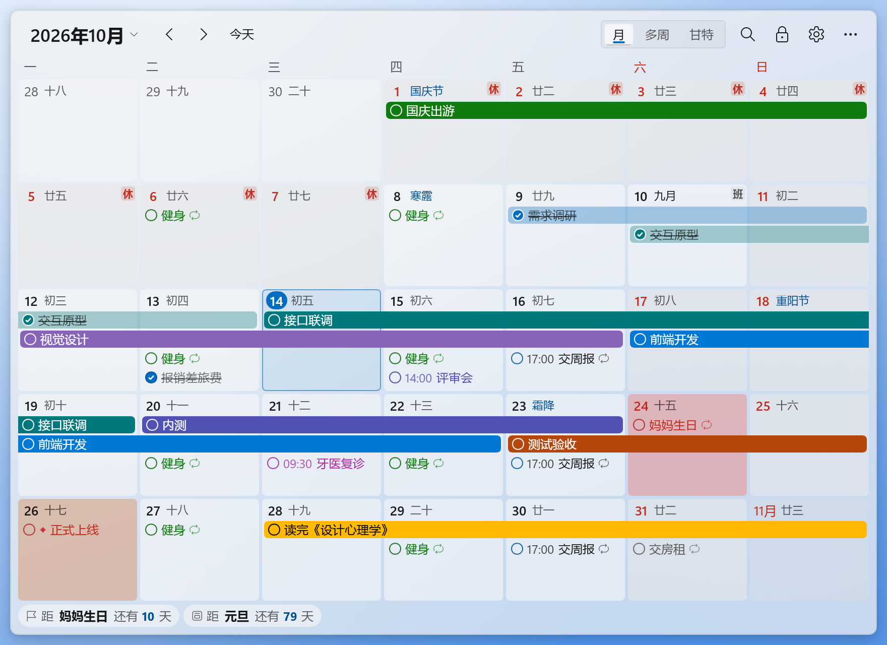
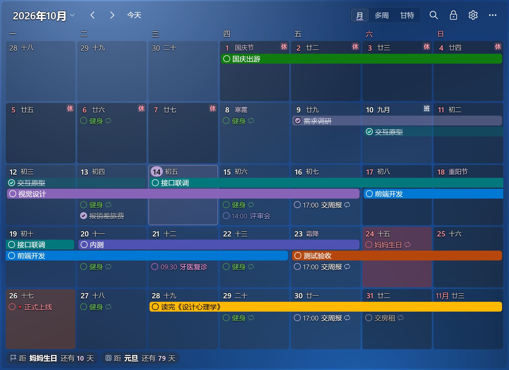
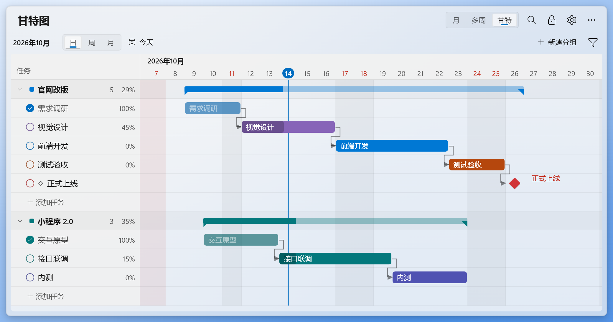
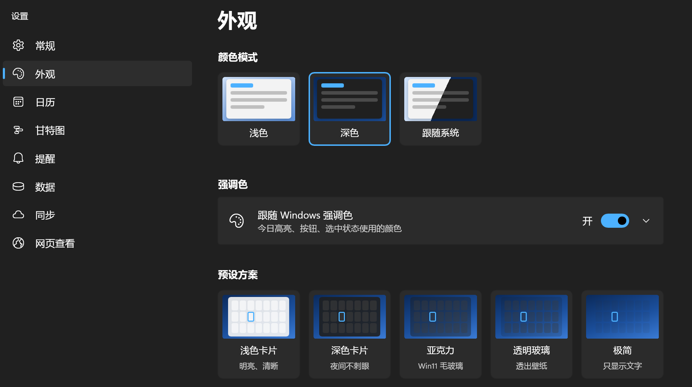
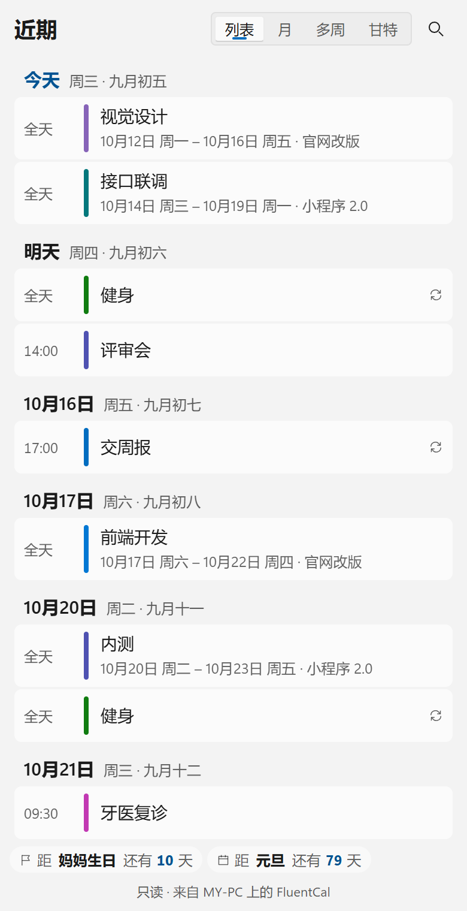
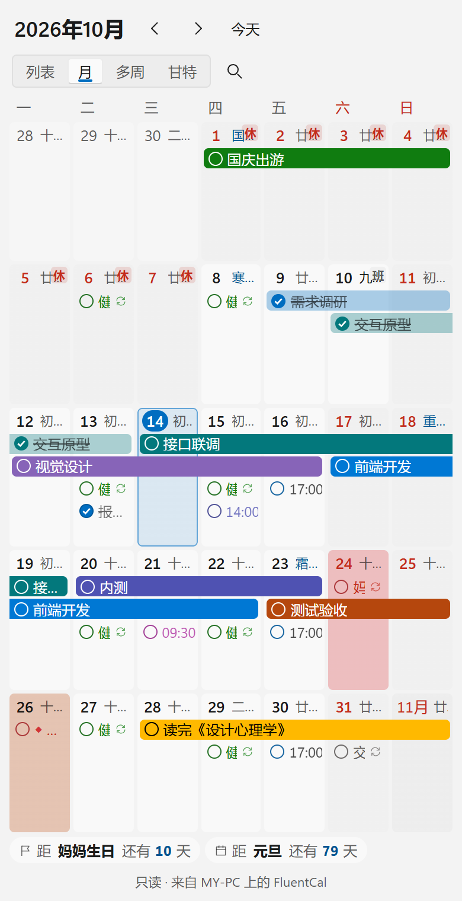

# FluentCal Desktop Calendar

[简体中文](README.md) · [繁體中文](README.zh-TW.md) · English

A calendar and Gantt chart pinned to the Windows desktop, in the Windows 11 Fluent style, with the Chinese lunar calendar, task reminders, cloud sync, and a Simplified Chinese, Traditional Chinese and English interface.

A native desktop app built with Rust and [Slint](https://slint.dev); no WebView2 needed. Your data is kept on your PC, it works offline, needs no account and has no ads.

An **Android client** is also available, with editable agendas, a calendar and a touch-friendly Gantt chart, QR pairing and automatic cloud sync.

[Get it from the Microsoft Store](https://apps.microsoft.com/store/detail/9NTT06453DG5?cid=DevShareMCLPCB) · [Download for Windows](https://github.com/Lianzy-Baimiao/FluentCal/releases/latest) · [Download Android APK](https://github.com/Lianzy-Baimiao/FluentCal/releases/tag/android-latest)



## Features

- **Pinned to the desktop**: sits below all windows, takes no taskbar space and stays visible after Win+D. It can also be switched to "Always on top" or "Normal window". You can lock its position or turn on "Click through". With several screens it can go on any of them, and it can be dragged straight across screens with different scaling.
- **Calendar**: month view and a scrolling multi-week view; the Chinese lunar calendar, the 24 solar terms and traditional festivals; Chinese public holidays with their off and work days (including make-up working days, updated online automatically).
- **Tasks**: double-click a date to add a task, tick to complete, drag to reschedule, right-click to recolor or delete; multi-day tasks show as bars; repeating tasks (daily, weekly, monthly, yearly, weekdays, official working days, lunar dates, end of month, Ebbinghaus review); reminders; search.
- **Gantt chart**: the same data as the calendar; day, week and month scales; drag a bar to change its dates, drag its ends to change the start or end, drag the dot at the bottom to set progress; drag from a bar's right end onto another bar to add a dependency; group summaries, milestones and dependency arrows; PNG/SVG export. Right-click a group row to delete groups: tick several at once; their tasks are deleted too by default, and it can be undone.
- **Appearance**: light, dark or system; the Windows accent color or your own; background color, opacity, acrylic blur, corner radius, font size and spacing; 5 presets.
- **Language**: follows the Windows display language by default. Switch between Simplified Chinese, Traditional Chinese and English in Settings › General › Display language; it takes effect at once and is remembered. The web view follows the browser's language and has its own menu at the top; other languages fall back to English. The language choice stays on this PC; task names, notes and group names are not translated.
- **Data**: saved on this PC in `%APPDATA%\com.fluentcal.desktop\data.json`, backed up daily; export to JSON, CSV (Excel) or ICS (Outlook, Google Calendar). The data folder can be moved to OneDrive or another synced folder and shared by several PCs: changes are merged by each task's last modification time, so the PCs don't overwrite each other; appearance, window position and other settings stay on each PC.
- **Reminders**: Windows notifications and/or a reminder card at the bottom right of the screen (Done, or remind again in 10 minutes), without taking focus.
- **Cloud sync**: share tasks between PCs through a WebDAV drive (Jianguoyun, Nextcloud, Synology and others) or a private GitHub/Gitee repository (each upload is a commit, so you can see the history). Changes are merged per task, so editing on two PCs at once doesn't overwrite anything. Passwords and tokens are kept only in Windows Credential Manager.
- **Web view**: right-click the calendar › "View in browser" to see the calendar, list and Gantt chart in this PC's browser. Turn on "Allow local network access" and phones and tablets on the same Wi-Fi can view it by scanning a QR code: no cloud sync and no app needed. It is view-only; changes on the PC appear within seconds; the link carries a random access code.

## Screenshots

The screenshots show the Simplified Chinese interface.

Dark theme, purple accent color and the "Clear glass" preset (the wallpaper shows through):



Gantt chart: dependency arrows, progress, group summaries and milestones, from the same data as the calendar:



Appearance settings: light, dark or system, accent color, presets, background, opacity, corner radius, font size and more:



Web view: the list and month views in a phone browser (view-only):

 

The screenshots use sample data. A gradient stands in for the wallpaper behind the desktop calendar; in real use, your desktop is behind it.

## Download and install

Installing from the [Microsoft Store](https://apps.microsoft.com/store/detail/9NTT06453DG5?cid=DevShareMCLPCB) is recommended; the Store then keeps it up to date.

You can also download `FluentCal_<version>_x64-setup.exe` from [GitHub Releases](https://github.com/Lianzy-Baimiao/FluentCal/releases/latest) and double-click it. The standalone installer installs for the current user and needs no administrator rights.

- Requirements: Windows 10 1809 or later, or Windows 11, x64. Developed and tested mainly on Windows 11 24H2 and later; not yet tested on a real Windows 10 PC.
- The standalone installer is not code-signed, so Windows SmartScreen may warn the first time; the Microsoft Store version is installed and updated by the Store.
- Upgrading keeps your data. Uninstalling the standalone version doesn't delete your data (`%APPDATA%\com.fluentcal.desktop`).

## Android client

[Download from GitHub](https://github.com/Lianzy-Baimiao/FluentCal/releases/tag/android-latest) and install `FluentCal-Android-0.3.2.apk`. Requires Android 7.0+ and Android System WebView 120+. The mobile interface is currently in Simplified Chinese.

The app supports task editing, repeating tasks, the lunar calendar, a touch-friendly Gantt chart, reminders, offline storage and automatic WebDAV / private GitHub or Gitee repository sync. Credentials are encrypted with Android Keystore.

1. Enable cloud sync on desktop version 0.3.7+ under Settings › Sync, then generate a pairing QR code.
2. Connect the phone and PC to the same local network. On the phone, open Settings › Automatic cloud sync › Scan to connect to PC (`扫码连接电脑`). The scanner opens in portrait orientation.
3. Choose to merge your data or use the cloud calendar. After pairing, the phone connects to the cloud independently; the PC can be offline.

Pairing codes expire after five minutes or one use. Sync runs on startup, resume, reconnection and edits, and periodically while the app is running. If Android suspends or stops the process, it catches up when reopened.

**Upgrading:** regular release APKs install over previous releases and keep data. If a 0.1.0 / 0.2.0 debug installation reports a signature mismatch, Android 9+ users can install `FluentCal-Android-0.3.2-legacy-upgrade.apk` once to migrate using signing-key rotation, then use normal release APKs. Android 7/8 users must export JSON, uninstall the old debug app, install the release and import the backup. Existing 0.3.0 release installations can use the normal APK directly.

The phone checks GitHub under Settings › Mobile updates. The desktop checks Microsoft Store under Settings › About; standalone installations are directed to the Store page. Store availability follows Microsoft's publication process.

Run `npm run android:dev` for a preview or `npm run android:apk` for a debug APK. See the [Android guide (Chinese)](docs/ANDROID.md) for signing and detailed setup.

## Common tasks

| Task | How |
|---|---|
| Bring up the calendar | `Ctrl+Alt+D` (press again to send it back to the desktop layer), or click the tray icon |
| New task quickly | `Ctrl+Alt+N`, or `Ctrl+N` in the calendar |
| Add tasks | Double-click a blank part of a date; Enter saves and starts the next one, Esc stops |
| Move and resize | Click 🔒 in the title bar to unlock → drag anywhere on the calendar, or drag an edge or corner → click "Done" |
| Switch language | Settings › General › Display language: System default, Simplified Chinese, Traditional Chinese or English; the web view uses the language menu at the top |
| Sync several PCs | Settings › Sync: choose a sync method and fill in the account → "Test connection" → "Enable sync". Turn it on with the same settings on the other PC; if both have data, choose to merge or to use the cloud data |
| Sync the Android app | Desktop Settings › Sync › Generate QR code; phone Settings › Automatic cloud sync › Scan to connect to PC. Use the same local network for pairing |
| View in browser | Right-click a date (in the Gantt chart, use the "More" menu in the title bar) › "View in browser", or the tray menu item of the same name. View-only; only this PC can open it |
| View on a phone | Settings › Web view: turn on "Allow local network access" and scan the QR code with your phone (on the same Wi-Fi as the PC). The first time, Windows Firewall asks: tick "Private networks" and allow |
| Show on another screen | "Display on" in the tray menu, or Settings › General › "Display on" (shown when there are several screens); in adjust mode you can also drag it there |
| Delete groups | Right-click a group row in the Gantt chart › "Delete group…", or the delete button in Settings › Gantt chart. Tick several groups to delete them at once; their tasks are deleted too by default, or untick "Also delete their tasks" to move them to "Ungrouped". It can be undone |
| Page / back to today | Mouse wheel or `PageUp`/`PageDown`; `Home` |
| Zoom the Gantt chart | `Ctrl` + mouse wheel |
| Search | `Ctrl+F` |
| Undo / redo | `Ctrl+Z` / `Ctrl+Y` (after deleting, there is also an "Undo" button at the bottom) |
| Clear sample data | "Clear sample data" in the bar shown at first start, or Settings › Data › "Clear sample data" (tasks you have renamed are kept) |

On the desktop layer, ordinary clicks don't take keyboard focus away from other apps by default. Before using the calendar's keyboard shortcuts, press `Ctrl+Alt+D` to bring up the calendar, and press it again when you are done to send it back to the desktop layer; double-clicking a date to add a task takes keyboard focus automatically. You can also turn off "Keep keyboard focus on other apps" in Settings › General.

## Development

The desktop app is in `native/`, built with Rust and Slint's software renderer. The Cargo workspace has two packages: `core` holds the calendar, task, storage and sync logic, and `app` holds the user interface and the Windows integration. The web view is Vue 3 + TypeScript, built and embedded in the desktop app.

You need Node.js 20+, stable Rust and a Windows build toolchain. The standalone installer also needs NSIS; run the `.sh` scripts in Git Bash.

```bash
npm install
npm run build                        # the web view's pages (dist/, embedded in the exe at build time)
npm test                             # unit tests of the web logic
npm run typecheck                    # TypeScript type check
cd native
cargo run -p fluentcal-native        # development run: test data in %APPDATA%\com.fluentcal.native.dev, separate from the installed app
cargo test --workspace               # all tests: calendar logic, storage, cloud sync, web service, themes, and end-to-end
cd ..
bash scripts/build-native.sh         # release exe + standalone installer (NSIS), placed next to the exe
bash scripts/build-msix.sh            # test MSIX package; the Store identity arguments are described at the top of the script
```

The end-to-end tests (`native/app/tests`) run the real app and simulate clicks, drags and key presses with Slint's headless testing backend, without showing a window. The cloud sync tests use in-memory mock servers (WebDAV, GitHub, Gitee); `native/core/tests/cloud_webdav.rs` and `cloud_git.rs` each have an `#[ignore]` test that can be run against a real WebDAV server and a private GitHub repository, as described in their comments. `native/core/tests/web.rs` tests the web view service on a local port: pages and access code, repeated polling on one connection (304), listening addresses, and answering only devices on the local network.

The Windows focus regression test needs a real window: run `cargo test -p fluentcal-native --test native_focus -- --ignored` in `native/`. It uses temporary data and checks that after moving the calendar and finishing, the inactive calendar still takes keyboard focus when a date is double-clicked, so a task can be typed and saved; the default test run skips it.

`cargo run --example dpi_probe` (in `native/app`) checks dragging the calendar between screens with different scaling, using window messages only (no mouse). It needs two side-by-side screens with different scales.

### Toolchain

On Windows, Rust uses the MSVC toolchain by default, which needs Visual Studio Build Tools (with "Desktop development with C++").

This project is developed and tested with the GNU toolchain (`x86_64-pc-windows-gnu`); MSVC builds haven't been tested. The local GNU toolchain settings are in `native/.cargo/config.toml`:

1. You need [llvm-mingw](https://github.com/mstorsjo/llvm-mingw): its `llvm-dlltool` makes the import libraries and `windres` compiles the icon resources. Add its `bin` folder to PATH before building.
2. The linker is the rust-lld that comes with rustc (hard-linked as `ld.exe`), because GNU ld links LLVM import libraries incorrectly.
3. If the project path contains non-ASCII characters, put the build folder (`target-dir`) under an ASCII-only path, because the GNU tools can't read such paths.

## Folders

```
native/core/src      logic without UI (tests in native/core/tests)
  date.rs, lunar.rs, holidays.rs     dates, lunar calendar and solar terms, public holidays
  recur.rs, tasks.rs, countdown.rs   repeat rules, tasks, countdowns; search.rs search
  layout.rs, gantt.rs                calendar layout, Gantt geometry; export.rs JSON/CSV/ICS export
  store.rs                           JSON storage: atomic writes, debouncing, daily backups, recovery from damage
  merge.rs, sync.rs                  per-item merging when PCs share a data folder, watching for outside changes; datadir.rs custom data folder
  cloud/                             cloud sync: engine.rs one sync round, service.rs scheduling, webdav.rs, git.rs (GitHub/Gitee), secrets.rs Credential Manager
  web.rs                             web view: local network HTTP service (access code, read-only data, static files)
  theme/, settings.rs, editor/       theme colors, settings, the editor's fields and merging
native/app
  ui/                  Slint UI: Fluent controls, calendar, Gantt chart, settings, editor, reminders
  src/desk/            the calendar window's interaction, menus, Gantt chart
  src/windows/         settings, editor and reminder windows
  src/platform/        Windows layer: pinning to the desktop (owner = Progman), tray, notifications, start with Windows, single instance, multiple screens, outside clicks
  src/shell/           tray menu, global shortcuts and single-instance messages
  installer/, package/ manifests of the standalone installer (NSIS) and the Microsoft Store package (MSIX)
  tests/               end-to-end tests
native/vendor          patched dependencies: Slint's software renderer (glyph hinting), winit (cross-screen drag fix); see the README.md there
src/windows/web        web view entry: calendar, list, Gantt chart and task details
src/fluent, src/lib    web Fluent components and shared logic
scripts               build, packaging, test and screenshot scripts
```

Requirements and design are in [需求文档.md](需求文档.md), progress in [TODO.md](TODO.md) (both in Chinese).

## Thanks

- Chinese public holiday data: [NateScarlet/holiday-cn](https://github.com/NateScarlet/holiday-cn)
- Lunar calendar, solar terms and almanac: [tyme4rs](https://github.com/6tail/tyme4rs) (native app, MIT), [tyme4ts](https://github.com/6tail/tyme4ts) (Vue front end, MIT)
- User interface: [Slint](https://slint.dev) (royalty-free license, which asks for a credit in "About")
- Windows and input: [winit](https://github.com/rust-windowing/winit) (Apache-2.0; the bundled copy carries the upstream fix for dragging across screens)
- Gantt PNG export: [resvg](https://github.com/linebender/resvg) (Apache-2.0 / MIT)
- QR codes: [qrcodegen](https://www.nayuki.io/page/qr-code-generator-library) (native app, MIT), [uqr](https://github.com/unjs/uqr) (Vue front end, MIT)
- Web interface: [Vue](https://vuejs.org) (MIT)
- Icons: the Segoe Fluent Icons font that comes with Windows (not distributed with the app)

## FAQ

- **The calendar disappears after Win+D?** Check that Settings › General › Window level is "Desktop layer".
- **The calendar's size jumps around when dragged between screens with different scaling?** Fixed in 0.3.6; please update to the latest version.
- **Can't click the desktop icons?** Icons under the calendar can't be clicked. Make the calendar smaller, move it to an empty area, or turn on "Click through" (turn it off again from the tray menu).
- **Holidays out of date?** Settings › General › Holidays › Check now. China's State Council usually publishes the next year's schedule in November.
- **Two PCs changed the same task?** The later change wins; changes to different tasks are all kept, and deletions sync too. Your local data is backed up automatically before sync is turned on and before it is replaced with the cloud data (Settings › Data › Backup files).
- **What is synced?** Tasks, groups and date colors. Appearance, window position and other settings stay on each PC; each PC downloads the holiday data itself.
- **Can it sync to Google Drive?** Install Google Drive for desktop and choose its synced folder in Settings › Data › "Data folder"; OneDrive and Dropbox work the same way.
- **Does the web view use extra resources?** Until you use "View in browser" or turn on local network access, the web service doesn't run and listens on no port. After you use it once, it listens only on this PC (127.0.0.1) until FluentCal quits. While a web page is open it checks every 5 seconds; when nothing changed, the answer is an empty 304 response. Checks pause while the page is in the background.
- **The phone can't open the web view link?** The phone and the PC must be on the same local network, and FluentCal must be running on the PC. If you clicked "Cancel" when the firewall asked the first time, go to Windows Security › Firewall & network protection › "Allow an app through firewall" and tick "Private" for FluentCal. If only "Private" is ticked and the PC's current network is "Public", it can't connect either; change it to "Private network" in Windows Settings › Network & internet. Guest Wi-Fi usually doesn't let devices reach each other.
- **Is the web view safe?** The link carries a 128-bit random access code, only devices on the local network get an answer, and the page is view-only. Traffic on the local network is not encrypted, so use it only on trusted networks such as home or work. If you sent the link to someone by mistake, click "Change access code" and the old link stops working at once.
