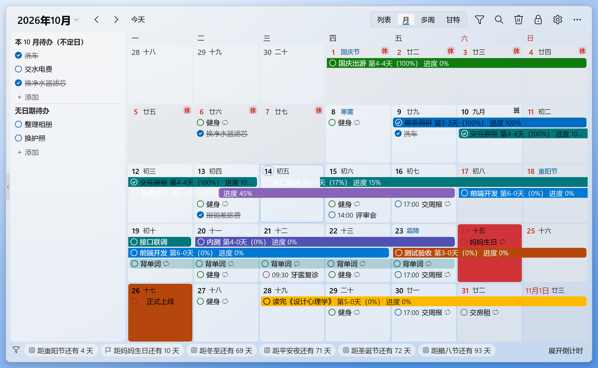
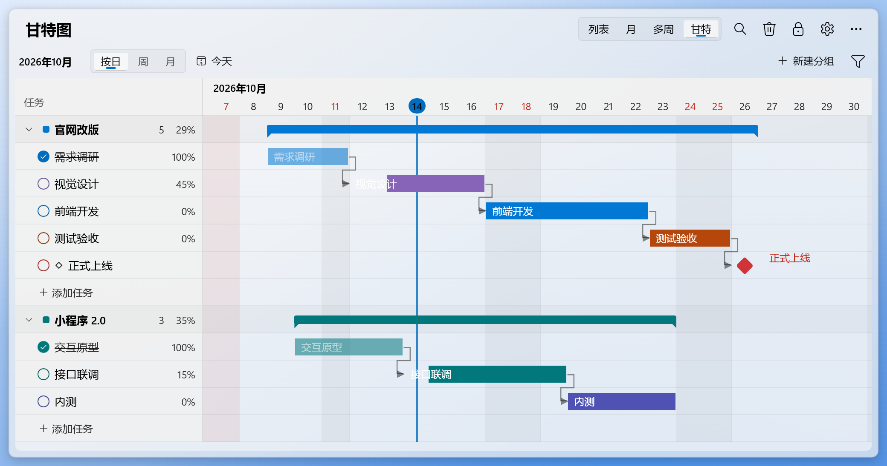
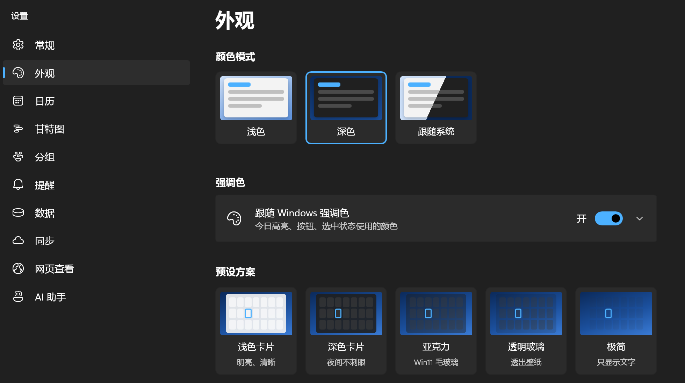
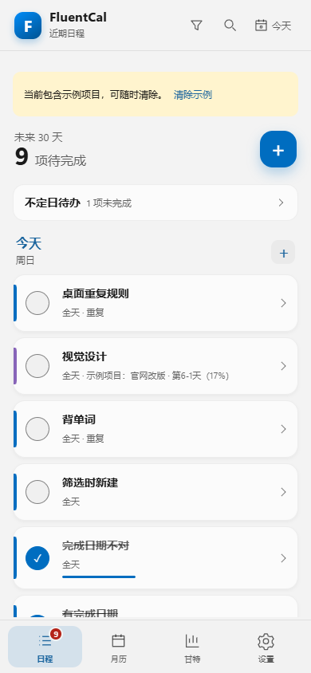

# FluentCal Desktop Calendar

[简体中文](README.md) · [繁體中文](README.zh-TW.md) · [English](README.en.md)

FluentCal is a native Windows desktop calendar and Gantt chart. Tasks, calendar entries and project plans share the same data. It works offline, needs no account and has no ads.

[Microsoft Store](https://apps.microsoft.com/store/detail/9NTT06453DG5?cid=DevShareMCLPCB) · [Windows installer](https://github.com/Lianzy-Baimiao/FluentCal/releases/latest) · [Android client](https://github.com/Lianzy-Baimiao/FluentCal/releases/tag/android-latest)

## Screenshots

Screenshots show the Simplified Chinese interface.

Read-only browser view on a phone:

## Features

- **Calendar and to-dos**: month, multi-week and list views; All lists undated to-dos and their actual completion dates; lunar dates, festivals and Chinese public holidays.
- **Gantt chart**: drag to schedule, track progress, view groups and dependencies, and export PNG/SVG.
- **Search and groups**: filter by group, optionally show group labels in lists, and undo recent changes.
- **Countdowns**: new installs show manually marked tasks and ordinary festivals. Statutory holidays, solar terms and task groups are optional; multi-day holidays count down from their first day.
- **Appearance**: light, dark or system themes; independently customize today's border, width and fill; adjust background, text and task colors with opacity.
- **Across devices**: optional WebDAV, GitHub or Gitee sync. The browser view is read-only; Android supports offline editing, Gantt charts and reminders.

Cloud sync, web viewing and AI assistant access are off by default and run only when enabled.

## Download

Install the Windows version from the [Microsoft Store](https://apps.microsoft.com/store/detail/9NTT06453DG5?cid=DevShareMCLPCB) or [GitHub Releases](https://github.com/Lianzy-Baimiao/FluentCal/releases/latest). Installing over an existing version keeps your data. Requires Windows 10 version 1809 or later, x64.

Download the Android APK from the [Android release page](https://github.com/Lianzy-Baimiao/FluentCal/releases/tag/android-latest). Requires Android 7.0+ and Android System WebView 120+. See the [Android guide](docs/ANDROID.md) for migration from early test builds.

## Quick actions

`Ctrl+Alt+D` show or tuck away the calendar · `Ctrl+Alt+N` add a task · `Ctrl+F` search · `Ctrl+Z` / `Ctrl+Y` undo / redo

Double-click an empty date to add a task. Right-click a task to complete, recolor, group or delete it. Report issues or request features in [GitHub Issues](https://github.com/Lianzy-Baimiao/FluentCal/issues).
