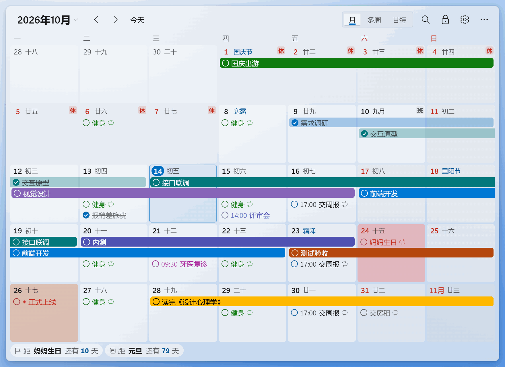
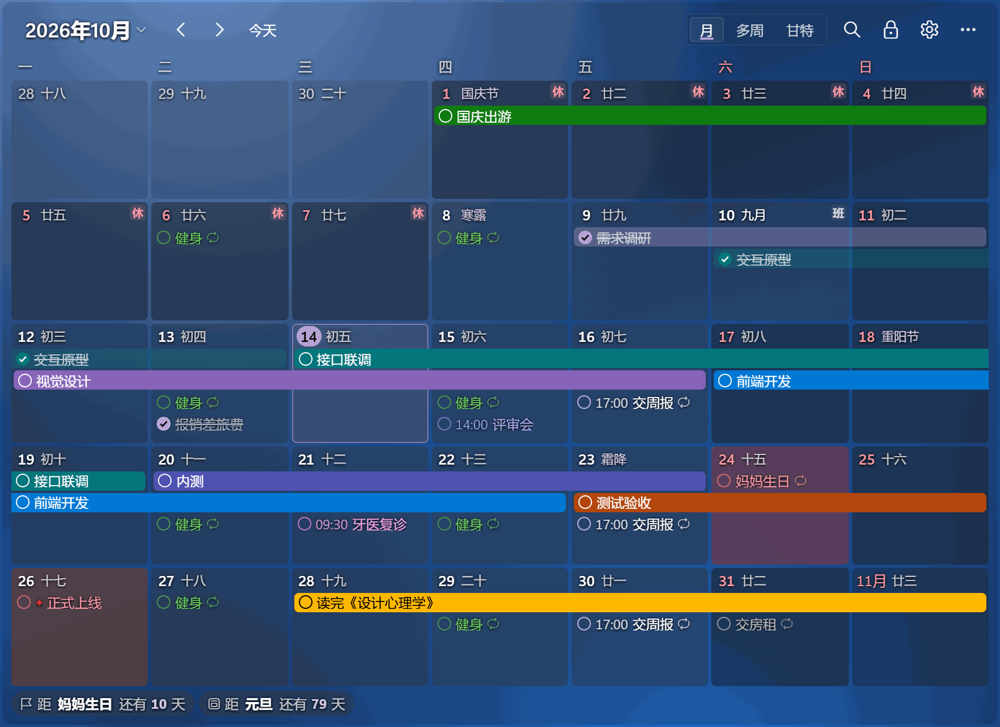
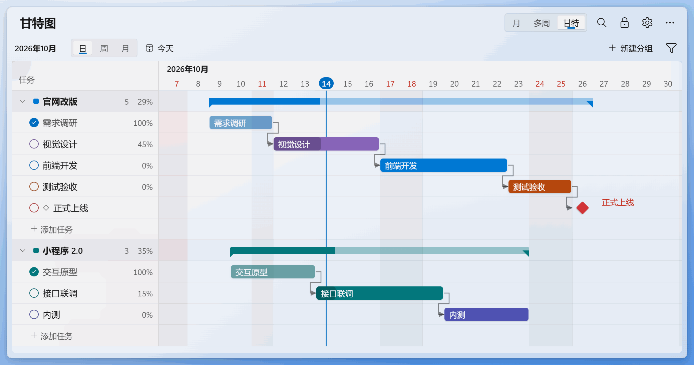
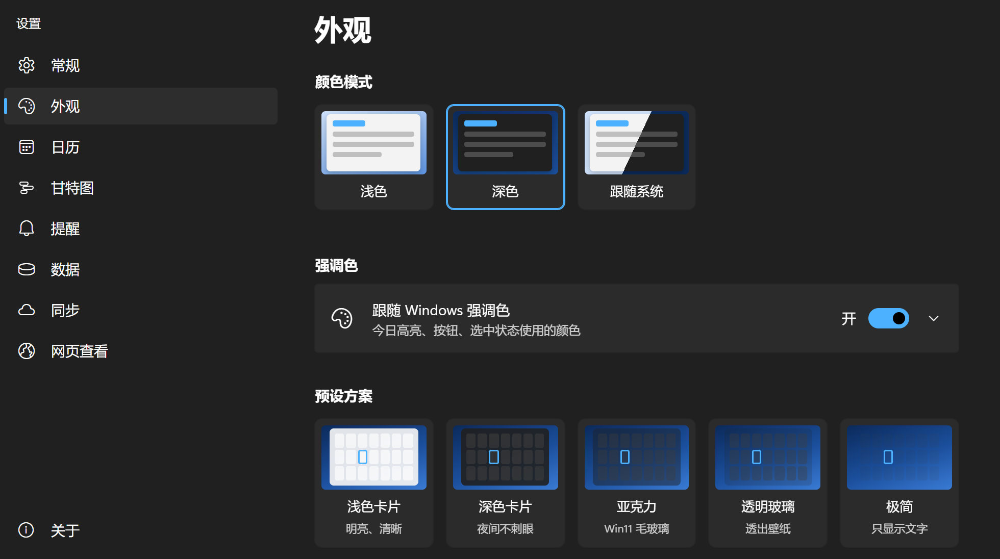
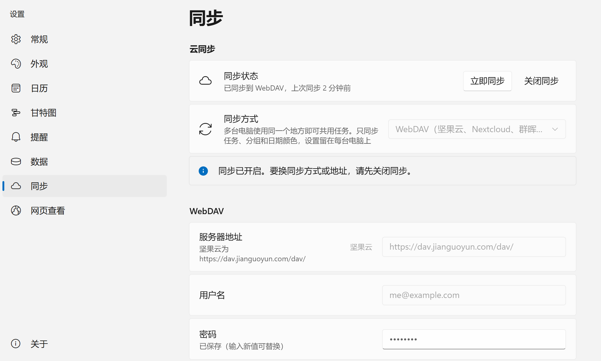
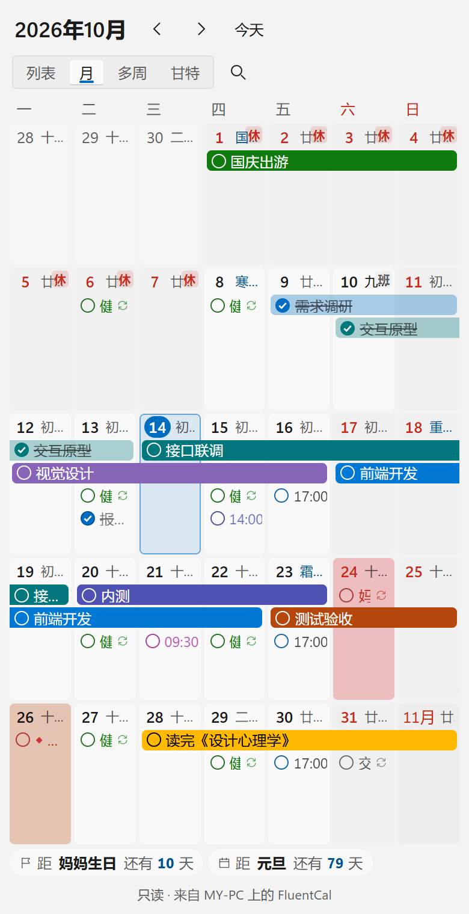

# FluentCal 桌面日历

钉在 Windows 桌面上的日历 + 甘特图，Windows 11 Fluent 风格，支持浅色/深色和自定义颜色。



- 需求与设计：[需求文档.md](需求文档.md)
- 开发进度：[TODO.md](TODO.md)

## 功能

- **钉在桌面**：位于所有窗口之下、不占任务栏，按 Win+D 显示桌面时仍可见；也可切换为“始终置顶”或“普通窗口”。可锁定位置、开启鼠标穿透。
- **日历**：月视图、多周滚动视图；农历、二十四节气、传统节日，法定节假日“休/班”（含调休，联网自动更新）。
- **任务**：双击日期快速添加，勾选完成，拖动改期，右键改颜色/删除；多日任务显示为横条；重复任务（每天/每周/每月/每年/工作日/法定工作日/农历/月末/艾宾浩斯）；提醒通知；搜索。
- **甘特图**：与日历同一份数据；日/周/月刻度；拖动任务条改日期、拖两端改起止、拖底部圆点改进度；从任务条右端拖到另一条创建依赖；分组汇总、里程碑、依赖箭头；导出 PNG/SVG。
- **外观**：浅色/深色/跟随系统，跟随 Windows 强调色或自选；背景色、透明度、亚克力毛玻璃、圆角、字号、间距；5 套预设方案。
- **数据**：默认保存在本机 `%APPDATA%\com.fluentcal.desktop\data.json`，每天自动备份；导出 JSON / CSV（Excel）/ ICS（Outlook、Google 日历）。数据文件夹可以改到 OneDrive 等同步盘，多台电脑共用：按每个任务的最后修改时间合并，不会互相覆盖；外观和窗口位置等设置留在每台电脑上。
- **提醒**：Windows 通知和/或屏幕右下角的提醒卡片（完成、10 分钟后再提醒），不抢焦点。
- **云同步**：多台电脑共用任务。可以同步到坚果云、Nextcloud、群晖等 WebDAV 网盘，GitHub/Gitee 私有仓库（每次上传是一次提交，可查看历史），或 Google 云端硬盘。按任务合并，同时修改不会互相覆盖。密码和 Token 只保存在 Windows 凭据管理器里。
- **网页查看**：在手机、平板或另一台电脑的浏览器里查看日历、列表和甘特图。网页由这台电脑上运行的 FluentCal 在局域网内提供，开启后扫二维码即可打开，不需要云同步，也不用装 App。只能查看；电脑上的修改几秒内出现在网页上；链接带随机访问码。

## 截图

深色主题、紫色强调色、“透明玻璃”预设（透出壁纸）：



甘特图：依赖箭头、进度、分组汇总、里程碑，和日历是同一份数据：



外观设置：浅色/深色/跟随系统、强调色、预设方案，以及背景、透明度、圆角、字号等：



同步设置：WebDAV、GitHub/Gitee 私有仓库、Google 云端硬盘，或者 OneDrive 等同步盘里的文件夹：



网页查看：手机浏览器里的列表视图和月视图（只读）：

 

截图用示例数据在浏览器预览中生成（`npm run readme-shots`），背景是代替桌面壁纸的渐变；实际使用时日历后面是你的桌面。

## 下载安装

到 [Releases](https://github.com/Lianzy-Baimiao/FluentCal/releases) 下载 `FluentCal_x.y.z_x64-setup.exe`，双击安装。安装到当前用户目录，不需要管理员权限。

- 系统：Windows 11（在 24H2 上开发和测试）。Windows 10 未测试。
- 安装包没有代码签名，Windows SmartScreen 可能提示“已保护你的电脑”：点“更多信息” →“仍要运行”。
- 依赖 WebView2，Windows 11 自带；缺少时安装程序会自动下载。
- 卸载不会删除数据（`%APPDATA%\com.fluentcal.desktop`）。

## 常用操作

| 操作 | 方式 |
|---|---|
| 唤出日历 | `Ctrl+Alt+D`（再按一次回到桌面层），或点托盘图标 |
| 快速新建任务 | `Ctrl+Alt+N`，或在日历里 `Ctrl+N` |
| 添加任务 | 双击日期空白处，回车保存并继续输入，Esc 结束 |
| 调整位置和大小 | 标题栏 🔒 按钮解锁 → 按住日历任意位置拖动、拖四边或四角调整大小 → 点“完成” |
| 多台电脑同步 | 设置 › 同步：选同步方式、填写账号 →“测试连接”→“开启同步”。另一台电脑用同样的设置开启，两边都有数据时可选合并或用云端数据 |
| 在手机上查看 | 设置 › 网页查看：打开开关，用手机扫二维码（手机和电脑连同一个 Wi-Fi）。第一次开启时 Windows 防火墙会询问，勾选“专用网络”并允许 |
| 换一块屏幕显示 | 托盘菜单“显示在”，或设置 › 常规 ›“显示在”（有多块屏幕时出现）；调整模式下也可以直接拖过去 |
| 翻页 / 回到今天 | 滚轮或 `PageUp`/`PageDown`；`Home` |
| 甘特图缩放 | `Ctrl` + 滚轮 |
| 搜索 | `Ctrl+F` |
| 撤销 / 重做 | `Ctrl+Z` / `Ctrl+Y`（删除后底部也有“撤销”按钮） |

## 开发

需要 Node.js 20+ 和 Rust（stable）。

```bash
npm install
npm run tauri dev      # 开发运行（桌面日历 + 热更新）
npm run tauri build    # 生成 NSIS 安装包，输出到 <target 目录>\release\bundle\nsis\
npm test               # 前端单元测试（vitest）
npm run typecheck      # 类型检查
npm run e2e            # 端到端测试（无界面 Edge，17 项交互）
npm run a11y           # 无障碍审计（axe-core）
npm run readme-shots   # 重新生成 docs/screenshots 下的 README 截图（示例数据、固定日期）
```

浏览器预览（不需要 Tauri，数据存在 localStorage）：`npm run dev` 后打开

- `http://localhost:1420/?w=desk&theme=dark` 桌面日历
- `http://localhost:1420/?w=settings&page=appearance` 设置
- `http://localhost:1420/?w=gallery` Fluent 组件库

Rust 测试：`cd src-tauri && cargo test`。云同步的测试用内存中的模拟服务器（WebDAV、GitHub、Gitee、Google）；`tests/cloud_webdav.rs` 和 `tests/cloud_git.rs` 里各有一项 `#[ignore]` 测试，可按注释对真实的 WebDAV 服务器和 GitHub 私有仓库运行。`tests/web.rs` 在本机端口上测试网页查看服务：访问码、返回的数据、304、路径穿越、响应头。

### 工具链

Windows 上 Rust 默认用 MSVC 工具链，需要 Visual Studio Build Tools（勾选“使用 C++ 的桌面开发”），这是 Tauri 的标准配置。

本项目实际是在没有 MSVC 的电脑上，用 GNU 工具链（`x86_64-pc-windows-gnu`）开发和测试的，MSVC 构建没有验证过。用 GNU 工具链时，把 `src-tauri/.cargo/config.toml.example` 复制为 `config.toml`，按里面的说明填写路径：

1. 需要 [llvm-mingw](https://github.com/mstorsjo/llvm-mingw)，用它的 `llvm-dlltool` 生成导入库，`windres` 编译图标资源。解压到 `~/tools/llvm-mingw` 时，`npm run tauri` 会自动把它加入 PATH。
2. 链接器用 rustc 自带的 rust-lld（做一个名为 `ld.exe` 的硬链接），因为 GNU ld 会把 LLVM 导入库链接错。
3. 项目路径含中文时，把构建目录（`target-dir`）设到纯英文路径下，因为 GNU 工具打不开中文路径下的文件。

## 目录

```
src-tauri/src
  desktop.rs         钉在桌面（所有者 = Progman + 强制置底）、鼠标穿透、亚克力、系统主题
  screens.rs         多显示器：选择屏幕、屏幕变化后拉回
  store.rs           JSON 存储：原子写入、防抖、每日备份、损坏自动恢复
  merge.rs, sync.rs  多台电脑共用数据文件夹时按条目合并、监视外部修改
  datadir.rs         自定义数据文件夹
  cloud/             云同步：engine.rs 一轮同步、service.rs 调度，webdav.rs、git.rs（GitHub/Gitee）、gdrive.rs + oauth.rs，secrets.rs 凭据管理器
  reminder.rs        提醒调度；reminder_popup.rs 右下角提醒卡片
  web.rs             网页查看：局域网 HTTP 服务（访问码、只读数据、静态文件）；webcmd.rs 开关、端口、本机地址
  tray.rs            托盘菜单
  lib.rs             窗口、快捷键、开机启动、命令
src
  fluent/      Windows 11 Fluent 组件库与主题
  lib/         日期、农历节假日、重复规则、日历布局、甘特几何、导出、合并等（核心逻辑有单元测试）
  stores/      数据与设置（多窗口同步、撤销/重做）
  windows/     desk（桌面日历 + 甘特图）、settings、editor、reminder、gallery、web（网页查看，数据经 webApi.ts 从 FluentCal 获取）
```

## 致谢

- 法定节假日数据：[NateScarlet/holiday-cn](https://github.com/NateScarlet/holiday-cn)
- 农历、节气、宜忌：[tyme4ts](https://github.com/6tail/tyme4ts)（MIT）
- 框架：[Tauri](https://tauri.app)（MIT / Apache-2.0）、[Vue](https://vuejs.org)（MIT）
- 二维码：[uqr](https://github.com/unjs/uqr)（MIT）
- 图标：Windows 自带的 Segoe Fluent Icons 字体（不随程序分发）

## 常见问题

- **按 Win+D 后日历消失了？** 确认设置 › 常规 › 窗口层级为“嵌入桌面”。
- **点不到桌面图标？** 日历盖住的区域点不到下面的图标；可以缩小日历、移到空白处，或开启“鼠标穿透”（在托盘菜单关闭）。
- **节假日不是最新的？** 设置 › 常规 › 节假日 › 立即检查。国务院通常在每年 11 月公布下一年安排。
- **两台电脑改了同一个任务？** 取最后修改的一方；不同任务的修改都保留，删除也会同步。开启同步前、用云端数据替换前都会自动备份本机数据（设置 › 数据 › 备份文件）。
- **同步了哪些内容？** 任务、分组和日期颜色。外观、窗口位置等设置留在每台电脑上；节假日数据每台电脑自己联网获取。
- **Google 云端硬盘为什么要自己创建 OAuth 客户端？** 开源程序无法内置经过 Google 审核的客户端。按设置页里的步骤创建一次，多台电脑用同一个即可。在国内访问 Google 需要代理（设置 › 同步 › 高级 › 网络代理）。
- **手机打不开网页查看的链接？** 手机和电脑要连同一个局域网，电脑上的 FluentCal 要在运行。第一次开启时如果在防火墙询问里点了“取消”，到 Windows 安全中心 › 防火墙和网络保护 ›“允许应用通过防火墙”，给 FluentCal 勾选“专用”。只勾选了“专用”而电脑当前的网络是“公用网络”时也连不上，可在 Windows 设置 › 网络和 Internet 里把它改为“专用网络”。访客 Wi-Fi 通常不允许设备之间互相访问。
- **网页查看安全吗？** 链接带 128 位随机访问码，只回应局域网内的设备，网页只能查看。局域网内传输没有加密，只在家里、公司等信任的网络中使用。链接不小心发给了别人，点“更换访问码”，旧链接立即失效。
