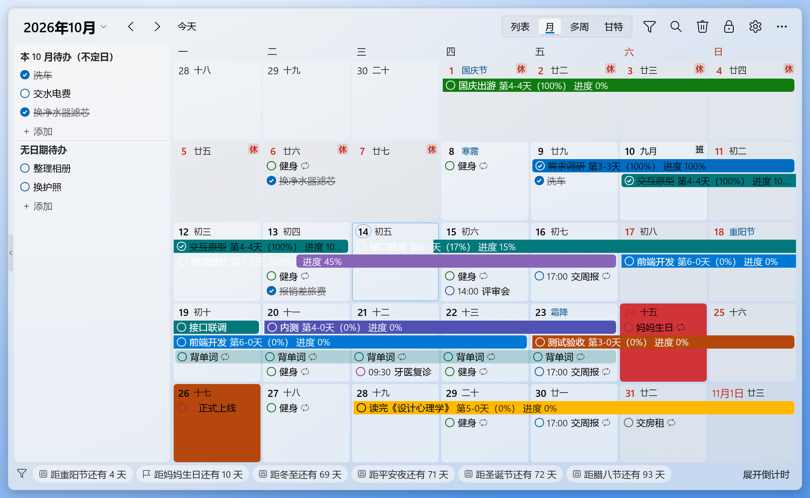
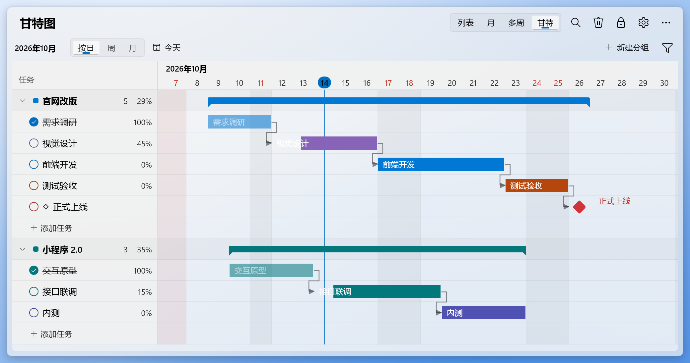
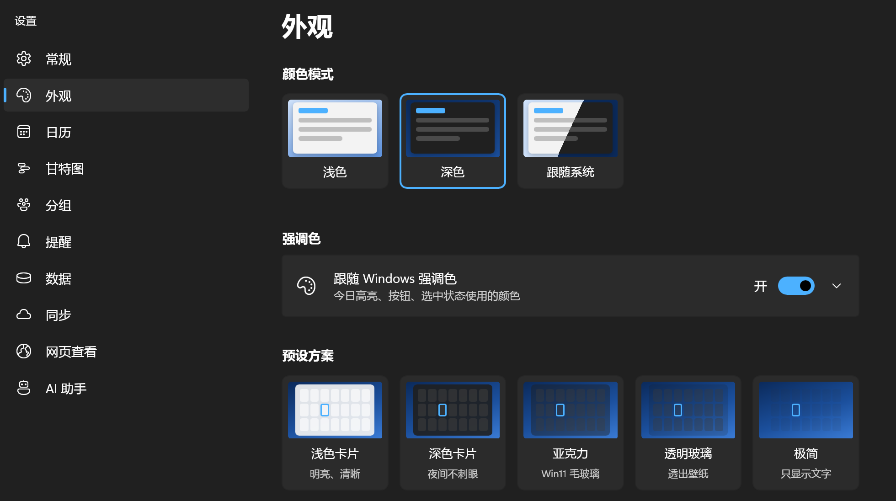
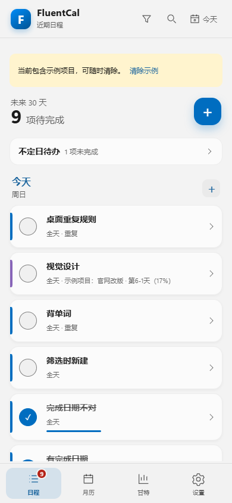

# FluentCal 桌面日历

[简体中文](README.md) · [繁體中文](README.zh-TW.md) · [English](README.en.md)

FluentCal 是一款原生 Windows 桌面日历与甘特图。任务、日历和项目计划共用一份数据，可离线使用，无需账号，没有广告。

[微软商店](https://apps.microsoft.com/store/detail/9NTT06453DG5?cid=DevShareMCLPCB) · [Windows 安装包](https://github.com/Lianzy-Baimiao/FluentCal/releases/latest) · [Android 客户端](https://github.com/Lianzy-Baimiao/FluentCal/releases/tag/android-latest)

## 截图

以下为简体中文界面。

手机浏览器中的只读网页查看：

## 功能

- **日历与待办**：月视图、多周视图和列表；农历、节气、节日与法定假期；重复任务和不定日待办。
- **甘特图**：拖动排期、调整进度、查看分组和依赖，导出 PNG/SVG。
- **搜索与分组**：按分组筛选，可选列表标签；最近更改支持撤销。
- **倒计时**：新安装默认显示手工标记和普通节日。法定假期、节气和任务分组可单独选择；多日假期从首日倒数。
- **外观**：浅色、深色或跟随系统；自定义背景、文字及任务颜色和透明度；调整字体与文字轮廓。
- **跨设备**：可选 WebDAV、GitHub 或 Gitee 同步。网页查看为只读，可在本机或局域网打开；Android 支持离线编辑、甘特图和提醒。

云同步、网页查看和 AI 助手连接默认关闭，启用后才会运行。

## 下载

从[微软商店](https://apps.microsoft.com/store/detail/9NTT06453DG5?cid=DevShareMCLPCB)或 [GitHub Releases](https://github.com/Lianzy-Baimiao/FluentCal/releases/latest) 安装 Windows 版。覆盖升级会保留数据。要求 Windows 10 1809 或更新版本，x64。

从[Android 发布页](https://github.com/Lianzy-Baimiao/FluentCal/releases/tag/android-latest)下载正式 APK；要求 Android 7.0+ 和 Android System WebView 120+。早期测试版迁移方法见 [Android 使用说明](docs/ANDROID.md)。

## 常用操作

`Ctrl+Alt+D` 显示或收起日历 · `Ctrl+Alt+N` 新建任务 · `Ctrl+F` 搜索 · `Ctrl+Z` / `Ctrl+Y` 撤销 / 重做

双击日期可新建任务，右键任务可完成、改色、分组或删除。问题反馈与功能建议：[GitHub Issues](https://github.com/Lianzy-Baimiao/FluentCal/issues)。
