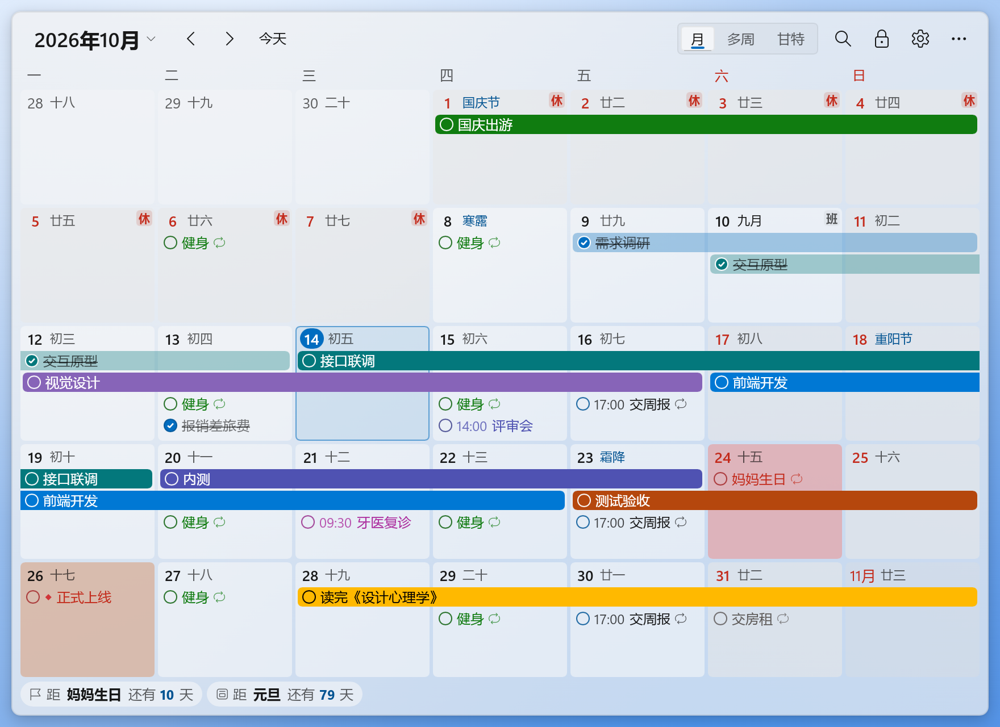
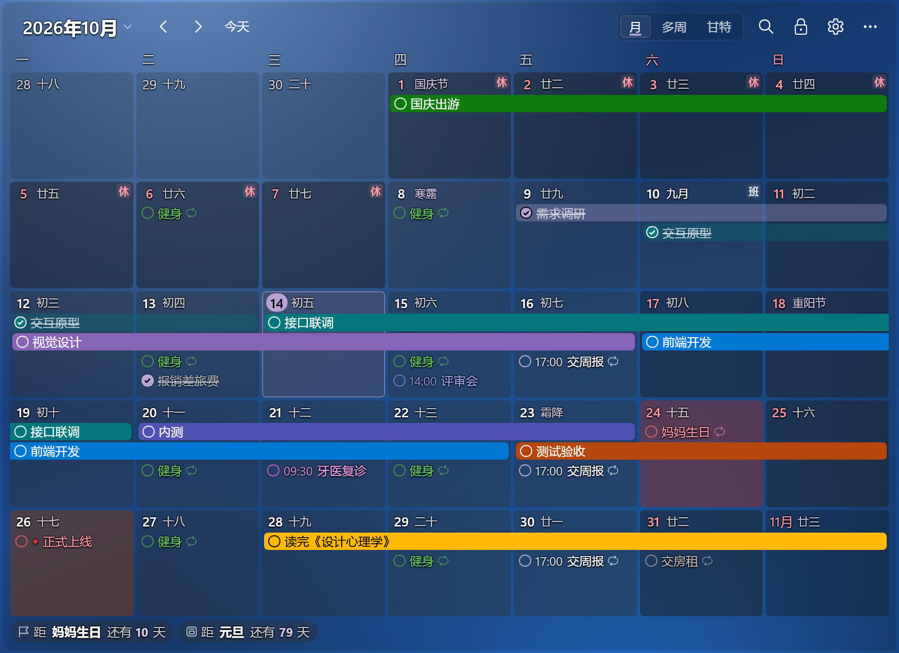
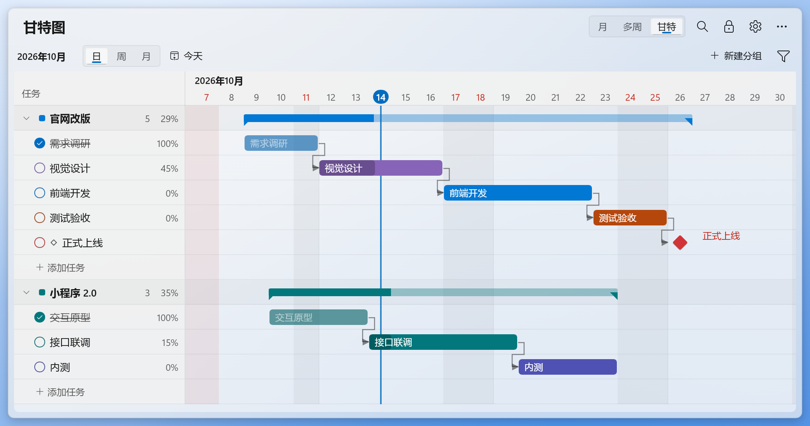
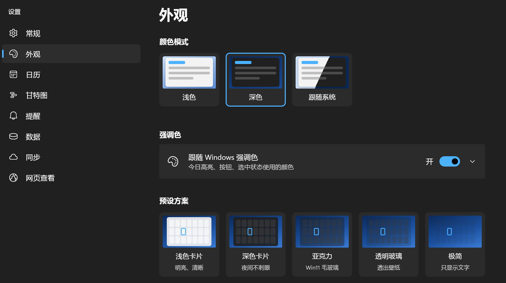
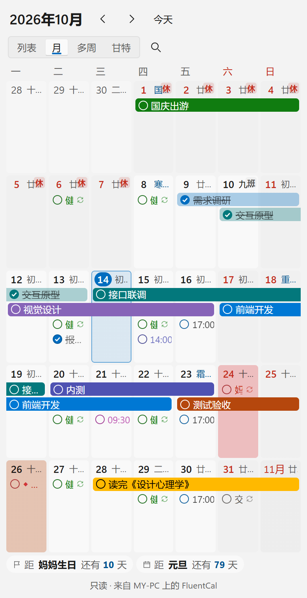

# FluentCal 桌面日历

钉在 Windows 桌面上的日历与甘特图，采用 Windows 11 Fluent 风格，支持农历、任务提醒、云同步，以及简体中文、繁体中文和英文。

使用 Rust + [Slint](https://slint.dev) 构建的原生桌面程序，无需 WebView2。数据保存在本机，可离线使用，无需账号，没有广告。

[从微软商店安装](https://apps.microsoft.com/store/detail/9NTT06453DG5?cid=DevShareMCLPCB) · [下载安装包](https://github.com/Lianzy-Baimiao/FluentCal/releases/latest)



## 功能

- **钉在桌面**：位于所有窗口之下、不占任务栏，按 Win+D 显示桌面时仍可见；也可切换为“始终置顶”或“普通窗口”。可锁定位置、开启鼠标穿透。
- **日历**：月视图、多周滚动视图；农历、二十四节气、传统节日，法定节假日“休/班”（含调休，联网自动更新）。
- **任务**：双击日期快速添加，勾选完成，拖动改期，右键改颜色/删除；多日任务显示为横条；重复任务（每天/每周/每月/每年/工作日/法定工作日/农历/月末/艾宾浩斯）；提醒通知；搜索。
- **甘特图**：与日历同一份数据；日/周/月刻度；拖动任务条改日期、拖两端改起止、拖底部圆点改进度；从任务条右端拖到另一条创建依赖；分组汇总、里程碑、依赖箭头；导出 PNG/SVG。
- **外观**：浅色/深色/跟随系统，跟随 Windows 强调色或自选；背景色、透明度、亚克力毛玻璃、圆角、字号、间距；5 套预设方案。
- **语言**：默认跟随 Windows 显示语言，可在设置 › 常规切换简体中文、繁体中文、English，立即生效并记住选择。网页查看默认跟随浏览器语言，可在顶部下拉框单独切换；未支持的语言回退到英文。语言偏好仅保存在当前设备，任务名称、备注和分组名称保留原文。
- **数据**：默认保存在本机 `%APPDATA%\com.fluentcal.desktop\data.json`，每天自动备份；导出 JSON / CSV（Excel）/ ICS（Outlook、Google 日历）。数据文件夹可以改到 OneDrive 等同步盘，多台电脑共用：按每个任务的最后修改时间合并，不会互相覆盖；外观和窗口位置等设置留在每台电脑上。
- **提醒**：Windows 通知和/或屏幕右下角的提醒卡片（完成、10 分钟后再提醒），不抢焦点。
- **云同步**：多台电脑共用任务。可以同步到坚果云、Nextcloud、群晖等 WebDAV 网盘，GitHub/Gitee 私有仓库（每次上传是一次提交，可查看历史）。按任务合并，同时修改不会互相覆盖。密码和 Token 只保存在 Windows 凭据管理器里。
- **网页查看**：日历上右键 ›“在浏览器中查看”，在这台电脑的浏览器里查看日历、列表和甘特图。打开“允许局域网内的设备查看”后，同一 Wi-Fi 的手机、平板扫二维码也能看，不需要云同步，也不用装 App。只能查看；电脑上的修改几秒内出现在网页上；链接带随机访问码。

## 截图

深色主题、紫色强调色、“透明玻璃”预设（透出壁纸）：



甘特图：依赖箭头、进度、分组汇总、里程碑，和日历是同一份数据：



外观设置：浅色/深色/跟随系统、强调色、预设方案，以及背景、透明度、圆角、字号等：



网页查看：手机浏览器里的列表视图和月视图（只读）：

 

截图使用示例数据；桌面日历截图中的渐变背景代替壁纸，实际使用时日历后面是你的桌面。

## 下载安装

推荐通过 [Microsoft Store](https://apps.microsoft.com/store/detail/9NTT06453DG5?cid=DevShareMCLPCB) 安装，后续更新由商店管理。

也可以在 [GitHub Releases](https://github.com/Lianzy-Baimiao/FluentCal/releases/latest) 下载 `FluentCal_<版本号>_x64-setup.exe`，双击安装。独立安装包安装到当前用户目录，不需要管理员权限。

- 系统要求：Windows 10 1809 及以上或 Windows 11，x64；主要在 Windows 11 24H2 上开发和测试，Windows 10 未实机验证。
- 独立安装包没有代码签名，首次安装可能出现 Windows SmartScreen 提示；微软商店版由商店安装和更新。
- 升级保留已有数据。独立安装包卸载时不会删除数据（`%APPDATA%\com.fluentcal.desktop`）。

## 常用操作

| 操作 | 方式 |
|---|---|
| 唤出日历 | `Ctrl+Alt+D`（再按一次回到桌面层），或点托盘图标 |
| 快速新建任务 | `Ctrl+Alt+N`，或在日历里 `Ctrl+N` |
| 添加任务 | 双击日期空白处，回车保存并继续输入，Esc 结束 |
| 调整位置和大小 | 标题栏 🔒 按钮解锁 → 按住日历任意位置拖动、拖四边或四角调整大小 → 点“完成” |
| 切换语言 | 设置 › 常规 › 显示语言：跟随系统、简体中文、繁体中文或 English；网页查看使用顶部语言下拉框 |
| 多台电脑同步 | 设置 › 同步：选同步方式、填写账号 →“测试连接”→“开启同步”。另一台电脑用同样的设置开启，两边都有数据时可选合并或用云端数据 |
| 在浏览器中查看 | 日期格子上右键（甘特图里用标题栏“更多”菜单）›“在浏览器中查看”，或托盘菜单里的同名项。只读，只有这台电脑能访问 |
| 在手机上查看 | 设置 › 网页查看：打开“允许局域网内的设备查看”，用手机扫二维码（手机和电脑连同一个 Wi-Fi）。第一次开启时 Windows 防火墙会询问，勾选“专用网络”并允许 |
| 换一块屏幕显示 | 托盘菜单“显示在”，或设置 › 常规 ›“显示在”（有多块屏幕时出现）；调整模式下也可以直接拖过去 |
| 翻页 / 回到今天 | 滚轮或 `PageUp`/`PageDown`；`Home` |
| 甘特图缩放 | `Ctrl` + 滚轮 |
| 搜索 | `Ctrl+F` |
| 撤销 / 重做 | `Ctrl+Z` / `Ctrl+Y`（删除后底部也有“撤销”按钮） |
| 清除示例数据 | 第一次启动时的提示条上点“清除示例数据”，或 设置 › 数据 ›“清除示例数据”（改过名称的任务会保留） |

嵌入桌面时，普通点击默认不抢走键盘焦点。使用日历快捷键前，先按 `Ctrl+Alt+D` 唤出日历，用完再按一次回到桌面层；双击日期添加任务时会自动取得输入焦点。也可以在 设置 › 常规 里关闭“点击日历时不抢焦点”。

## 开发

桌面程序位于 `native/`，使用 Rust + Slint 软件渲染。Cargo 工作区包含两个包：`core` 负责日历、任务、存储与同步逻辑，`app` 负责界面和 Windows 平台集成。网页查看使用 Vue 3 + TypeScript，构建后嵌入桌面程序。

需要 Node.js 20+、Rust stable 和 Windows 构建工具链。打独立安装包还需要 NSIS；`.sh` 脚本在 Git Bash 中运行。

```bash
npm install
npm run build                        # 网页查看的页面（dist/，构建时嵌进 exe）
npm test                             # 网页逻辑单元测试
npm run typecheck                    # TypeScript 类型检查
cd native
cargo run -p fluentcal-native        # 开发运行：测试数据在 %APPDATA%\com.fluentcal.native.dev，与已安装的版本互不影响
cargo test --workspace               # 全部测试：日历逻辑、存储、云同步、网页服务、主题，以及端到端
cd ..
bash scripts/build-native.sh         # 发布版 exe + 独立安装包（NSIS），安装包放在 exe 旁边
bash scripts/build-msix.sh            # 测试 MSIX 包；正式商店身份参数见脚本开头说明
```

端到端测试（`native/app/tests`）运行真实程序，用 Slint 的无头测试后端模拟点击、拖动和按键，不显示窗口。云同步的测试用内存中的模拟服务器（WebDAV、GitHub、Gitee）；`native/core/tests/cloud_webdav.rs` 和 `cloud_git.rs` 里各有一项 `#[ignore]` 测试，可按注释对真实的 WebDAV 服务器和 GitHub 私有仓库运行。`native/core/tests/web.rs` 在本机端口上测试网页查看服务：页面与访问码、同一连接上的连续轮询（304）、监听地址、只回应局域网设备。

Windows 焦点回归测试需要真实窗口，在 `native/` 下单独运行 `cargo test -p fluentcal-native --test native_focus -- --ignored`。它使用临时数据，验证调整位置、完成调整后，未激活的日历仍能在双击日期时取得键盘焦点、输入并保存任务；默认测试集会跳过它。

### 工具链

Windows 上 Rust 默认用 MSVC 工具链，需要 Visual Studio Build Tools（勾选“使用 C++ 的桌面开发”）。

本项目使用 GNU 工具链（`x86_64-pc-windows-gnu`）开发和测试，MSVC 构建尚未验证。GNU 工具链的本机配置放在 `native/.cargo/config.toml`：

1. 需要 [llvm-mingw](https://github.com/mstorsjo/llvm-mingw)，用它的 `llvm-dlltool` 生成导入库，`windres` 编译图标资源；构建前把它的 `bin` 加入 PATH。
2. 链接器用 rustc 自带的 rust-lld（做一个名为 `ld.exe` 的硬链接），因为 GNU ld 会把 LLVM 导入库链接错。
3. 项目路径含中文时，把构建目录（`target-dir`）设到纯英文路径下，避免 GNU 工具无法读取路径。

## 目录

```
native/core/src      与界面无关的逻辑（测试在 native/core/tests）
  date.rs, lunar.rs, holidays.rs     日期、农历节气、法定节假日
  recur.rs, tasks.rs, countdown.rs   重复规则、任务、倒数日；search.rs 搜索
  layout.rs, gantt.rs                日历布局、甘特图几何；export.rs 导出 JSON/CSV/ICS
  store.rs                           JSON 存储：原子写入、防抖、每日备份、损坏自动恢复
  merge.rs, sync.rs                  多台电脑共用数据文件夹时按条目合并、监视外部修改；datadir.rs 自定义数据文件夹
  cloud/                             云同步：engine.rs 一轮同步、service.rs 调度，webdav.rs、git.rs（GitHub/Gitee），secrets.rs 凭据管理器
  web.rs                             网页查看：局域网 HTTP 服务（访问码、只读数据、静态文件）
  theme/, settings.rs, editor/       主题颜色、设置、编辑窗口的字段与合并
native/app
  ui/                  Slint 界面：Fluent 控件、日历、甘特图、设置、编辑、提醒
  src/desk/            日历窗口的交互、菜单、甘特图
  src/windows/         设置、编辑、提醒窗口
  src/platform/        Windows 平台层：钉在桌面（所有者 = Progman）、托盘、通知、开机启动、单实例、多显示器、窗口外点击
  src/shell/           托盘菜单、全局快捷键和单实例消息的处理
  installer/, package/ 独立安装包（NSIS）和 Microsoft Store 包（MSIX）的清单
  tests/               端到端测试
native/vendor          打了补丁的 Slint 软件渲染器
src/windows/web        网页查看入口：日历、列表、甘特图和任务详情
src/fluent, src/lib    网页 Fluent 组件和共享逻辑
scripts               构建、打包、测试和截图脚本
```

需求与设计见 [需求文档.md](需求文档.md)，开发进度见 [TODO.md](TODO.md)。

## 致谢

- 法定节假日数据：[NateScarlet/holiday-cn](https://github.com/NateScarlet/holiday-cn)
- 农历、节气、宜忌：[tyme4rs](https://github.com/6tail/tyme4rs)（原生版，MIT）、[tyme4ts](https://github.com/6tail/tyme4ts)（Vue 前端，MIT）
- 界面：[Slint](https://slint.dev)（免版税许可证，需在“关于”中注明）
- 甘特图导出 PNG：[resvg](https://github.com/linebender/resvg)（Apache-2.0 / MIT）
- 二维码：[qrcodegen](https://www.nayuki.io/page/qr-code-generator-library)（原生版，MIT）、[uqr](https://github.com/unjs/uqr)（Vue 前端，MIT）
- 网页界面：[Vue](https://vuejs.org)（MIT）
- 图标：Windows 自带的 Segoe Fluent Icons 字体（不随程序分发）

## 常见问题

- **按 Win+D 后日历消失了？** 确认设置 › 常规 › 窗口层级为“嵌入桌面”。
- **点不到桌面图标？** 日历盖住的区域点不到下面的图标；可以缩小日历、移到空白处，或开启“鼠标穿透”（在托盘菜单关闭）。
- **节假日不是最新的？** 设置 › 常规 › 节假日 › 立即检查。国务院通常在每年 11 月公布下一年安排。
- **两台电脑改了同一个任务？** 取最后修改的一方；不同任务的修改都保留，删除也会同步。开启同步前、用云端数据替换前都会自动备份本机数据（设置 › 数据 › 备份文件）。
- **同步了哪些内容？** 任务、分组和日期颜色。外观、窗口位置等设置留在每台电脑上；节假日数据每台电脑自己联网获取。
- **能同步到 Google 云端硬盘吗？** 装 Google Drive 桌面版，在 设置 › 数据 ›“数据文件夹”里选它同步的文件夹即可，OneDrive、Dropbox 也一样。
- **网页查看会多占资源吗？** 没用过“在浏览器中查看”、也没打开局域网开关时，网页服务不运行，不监听任何端口。用过一次后，服务只监听本机（127.0.0.1），直到 FluentCal 退出。开着网页时每 5 秒检查一次，数据没有变化时只返回一个空的 304 响应；网页切到后台时暂停检查。
- **手机打不开网页查看的链接？** 手机和电脑要连同一个局域网，电脑上的 FluentCal 要在运行。第一次开启时如果在防火墙询问里点了“取消”，到 Windows 安全中心 › 防火墙和网络保护 ›“允许应用通过防火墙”，给 FluentCal 勾选“专用”。只勾选了“专用”而电脑当前的网络是“公用网络”时也连不上，可在 Windows 设置 › 网络和 Internet 里把它改为“专用网络”。访客 Wi-Fi 通常不允许设备之间互相访问。
- **网页查看安全吗？** 链接带 128 位随机访问码，只回应局域网内的设备，网页只能查看。局域网内传输没有加密，只在家里、公司等信任的网络中使用。链接不小心发给了别人，点“更换访问码”，旧链接立即失效。
