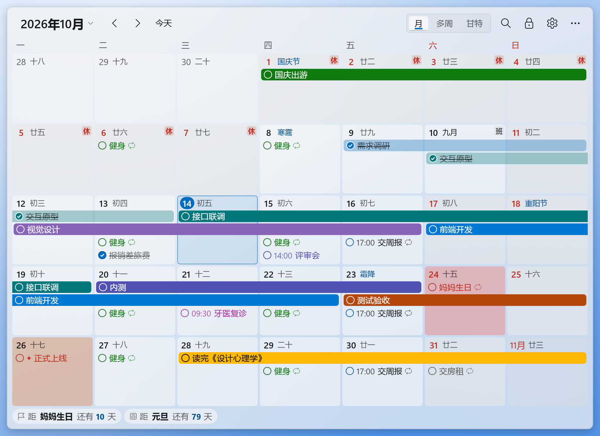
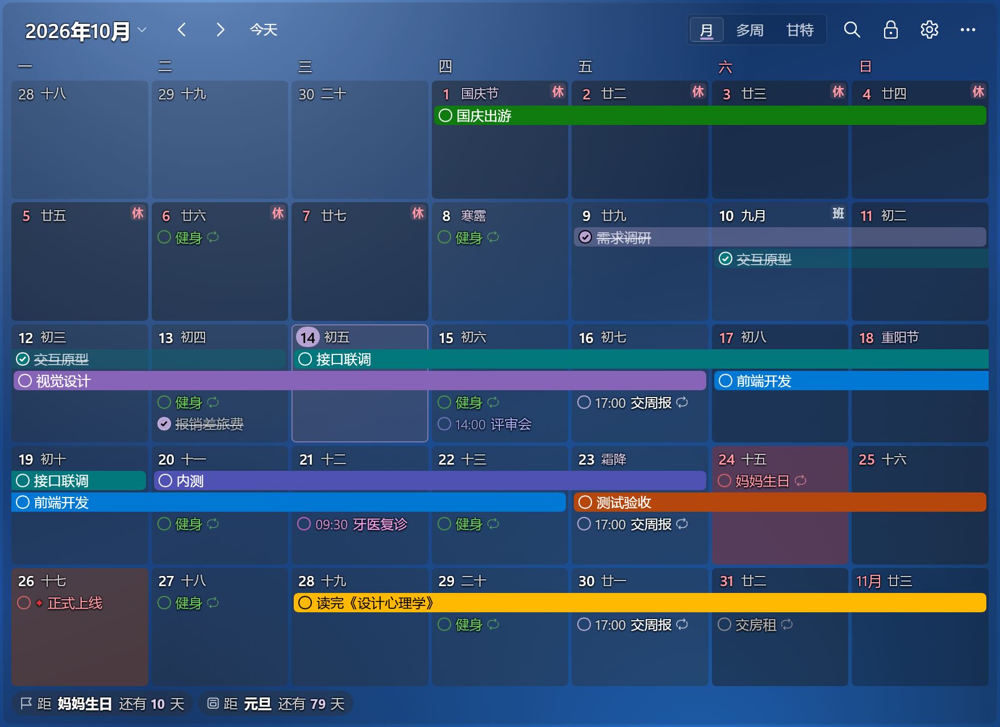
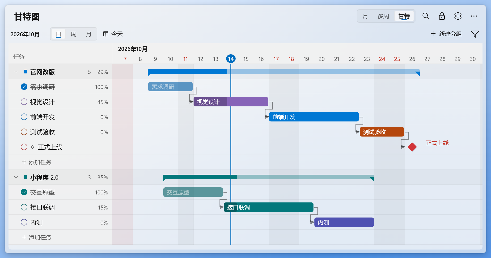
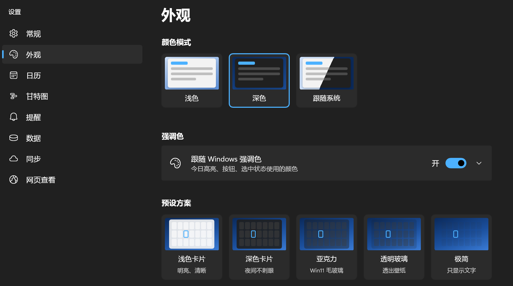
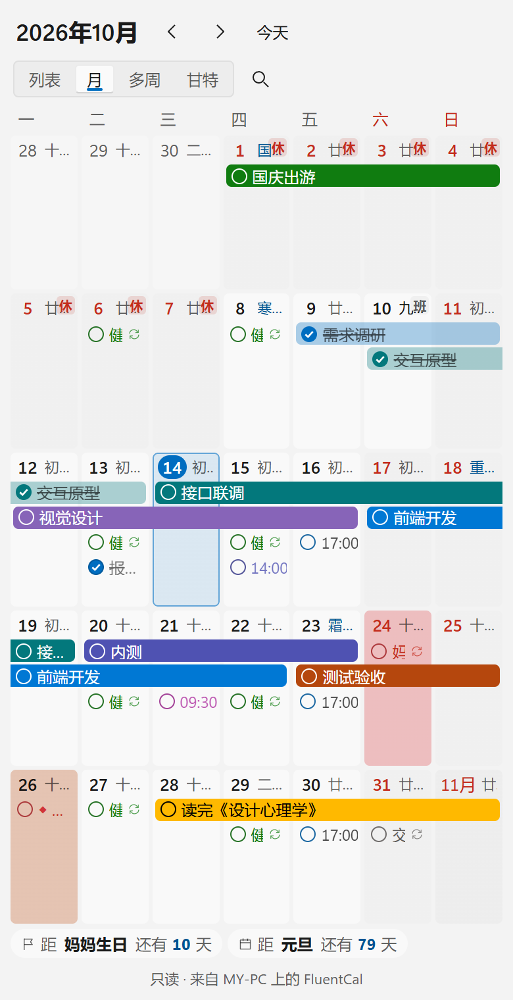

# FluentCal 桌面日曆

[简体中文](README.md) · 繁體中文 · [English](README.en.md)

釘在 Windows 桌面上的日曆與甘特圖，採用 Windows 11 Fluent 風格，支援農曆、任務提醒、雲端同步，以及簡體中文、繁體中文和英文。

使用 Rust + [Slint](https://slint.dev) 建置的原生桌面程式，不需要 WebView2。資料儲存在本機，可離線使用，不需要帳號，沒有廣告。

另提供 **Android 用戶端**，可在手機編輯日程、月曆與甘特圖，掃碼連接電腦並自動雲端同步。

[從微軟商店安裝](https://apps.microsoft.com/store/detail/9NTT06453DG5?cid=DevShareMCLPCB) · [下載 Windows 安裝包](https://github.com/Lianzy-Baimiao/FluentCal/releases/latest) · [下載 Android APK](https://github.com/Lianzy-Baimiao/FluentCal/releases/tag/android-latest)



## 功能

- **釘在桌面**：位於所有視窗之下、不佔工作列，按 Win+D 顯示桌面時仍可見；也可切換為“始終置頂”或“普通視窗”。可鎖定位置、開啟滑鼠穿透。有多塊螢幕時可以放到任意一塊上，縮放比例不同的螢幕之間也能直接拖過去。
- **日曆**：月檢視、多周捲動檢視；農曆、二十四節氣、傳統節日，法定節假日“休/班”（含調休，連網自動更新）。
- **任務**：雙擊日期快速新增，勾選完成，拖動改期，右鍵改顏色/刪除；多日任務顯示為橫條；重複任務（每天/每週/每月/每年/工作日/法定工作日/農曆/月末/艾賓浩斯）；提醒通知；搜尋。
- **甘特圖**：與日曆同一份資料；日/週/月刻度；拖動任務條改日期、拖兩端改起訖、拖底部圓點改進度；從任務條右端拖到另一條建立依賴；分組彙總、里程碑、依賴箭頭；匯出 PNG/SVG。分組列右鍵可刪除分組，可一次勾選多個，組內任務預設一起刪除，可以撤銷。
- **外觀**：淺色/深色/跟隨系統，跟隨 Windows 強調色或自選；背景色、透明度、亞克力毛玻璃、圓角、字型大小、間距；5 套預設方案。
- **語言**：預設跟隨 Windows 顯示語言，可在 設定 › 常規 切換簡體中文、繁體中文、English，立即生效並記住選擇。網頁檢視預設跟隨瀏覽器語言，可在頂部下拉框單獨切換；未支援的語言回退到英文。語言偏好只儲存在目前的電腦上，任務名稱、備註和分組名稱保留原文。
- **資料**：預設儲存在本機 `%APPDATA%\com.fluentcal.desktop\data.json`，每天自動備份；匯出 JSON / CSV（Excel）/ ICS（Outlook、Google 日曆）。資料資料夾可以改到 OneDrive 等同步盤，多臺電腦共用：按每個任務的最後修改時間合併，不會互相覆蓋；外觀和視窗位置等設定留在每臺電腦上。
- **提醒**：Windows 通知和/或螢幕右下角的提醒卡片（完成、10 分鐘後再提醒），不搶焦點。
- **雲端同步**：多臺電腦共用任務。可以同步到堅果雲、Nextcloud、群暉等 WebDAV 網路硬碟，GitHub/Gitee 私有儲存庫（每次上傳是一次提交，可檢視歷史）。按任務合併，同時修改不會互相覆蓋。密碼和 Token 只儲存在 Windows 憑據管理器裡。
- **網頁檢視**：日曆上右鍵 ›“在瀏覽器中檢視”，在這臺電腦的瀏覽器裡檢視日曆、列表和甘特圖。開啟“允許區域網內的裝置檢視”後，同一 Wi-Fi 的手機、平板掃二維碼也能看，不需要雲端同步，也不用裝 App。只能檢視；電腦上的修改幾秒內出現在網頁上；連結帶隨機訪問碼。

## 截圖

截圖是簡體中文介面。

深色主題、紫色強調色、“透明玻璃”預設（透出桌布）：



甘特圖：依賴箭頭、進度、分組彙總、里程碑，和日曆是同一份資料：



外觀設定：淺色/深色/跟隨系統、強調色、預設方案，以及背景、透明度、圓角、字型大小等：



網頁檢視：手機瀏覽器裡的列表檢視和月檢視（唯讀）：

 

截圖使用示例資料；桌面日曆截圖中的漸層背景代替桌布，實際使用時日曆後面是你的桌面。

## 下載安裝

建議透過 [Microsoft Store](https://apps.microsoft.com/store/detail/9NTT06453DG5?cid=DevShareMCLPCB) 安裝，後續更新由商店管理。

也可以在 [GitHub Releases](https://github.com/Lianzy-Baimiao/FluentCal/releases/latest) 下載 `FluentCal_<版本號>_x64-setup.exe`，雙擊安裝。獨立安裝包安裝到目前使用者的目錄，不需要系統管理員權限。

- 系統需求：Windows 10 1809 及以上或 Windows 11，x64；主要在 Windows 11 24H2 及以上開發和測試，Windows 10 未實機驗證。
- 獨立安裝包沒有程式碼簽章，首次安裝可能出現 Windows SmartScreen 提示；微軟商店版由商店安裝和更新。
- 升級保留已有資料。獨立安裝包解除安裝時不會刪除資料（`%APPDATA%\com.fluentcal.desktop`）。

## Android 用戶端

[從 GitHub 下載](https://github.com/Lianzy-Baimiao/FluentCal/releases/tag/android-latest)，安裝 `FluentCal-Android-0.3.1.apk`。需要 Android 7.0 及以上、Android System WebView 120 及以上；目前手機介面為簡體中文。

支援日程、農曆月曆、觸控甘特圖、任務編輯、重複任務、系統提醒、離線儲存，以及 WebDAV / GitHub / Gitee 自動雲端同步。密碼與權杖以 Android Keystore 加密儲存。

1. 在桌面 0.3.7+ 的「設定 → 同步」設定並啟用雲端同步，然後產生配對二維碼。
2. 手機與電腦連接同一區域網路，在手機「設定 → 自動雲端同步 → 掃碼連接電腦」（介面文字為「扫码连接电脑」）直向掃描。
3. 選擇合併資料或使用雲端日曆。配對後手機獨立連接雲端，電腦無需一直執行。

二維碼有效 5 分鐘，使用一次即失效。手機會在啟動、恢復前景、連網、編輯後及執行期間定時同步；系統暫停或結束應用程式後，下次開啟再補同步。

**更新與舊版遷移**：正式版可以直接覆蓋安裝並保留資料。已安裝 0.1.0 / 0.2.0 測試包、遇到簽章不符的 Android 9+ 使用者，先安裝發布頁的 `FluentCal-Android-0.3.1-legacy-upgrade.apk`，透過簽章輪換保留資料遷移，之後使用一般正式版即可。Android 7/8 不支援該輪換，需先匯出 JSON，再解除安裝測試包、安裝正式版並匯入。已安裝 0.3.0 正式版的使用者直接下載一般 APK。

手機「設定 → 行動端更新」檢查 GitHub 新版本；桌面「設定 → 關於」檢查 Microsoft Store 更新。非商店安裝會提示前往商店查看；商店版本以實際發布進度為準。

開發預覽使用 `npm run android:dev`，測試 APK 使用 `npm run android:apk`。正式簽章及詳細說明見 [Android 用戶端文件（簡體中文）](docs/ANDROID.md)。

## 常用操作

| 操作 | 方式 |
|---|---|
| 喚出日曆 | `Ctrl+Alt+D`（再按一次回到桌面層），或點托盤圖示 |
| 快速新建任務 | `Ctrl+Alt+N`，或在日曆裡 `Ctrl+N` |
| 新增任務 | 雙擊日期空白處，Enter 儲存並繼續輸入，Esc 結束 |
| 調整位置和大小 | 標題列 🔒 按鈕解鎖 → 按住日曆任意位置拖動、拖四邊或四角調整大小 → 點“完成” |
| 切換語言 | 設定 › 常規 › 顯示語言：跟隨系統、簡體中文、繁體中文或 English；網頁檢視使用頂部語言下拉框 |
| 多臺電腦同步 | 設定 › 同步：選同步方式、填寫帳號 →“測試連線”→“開啟同步”。另一臺電腦用同樣的設定開啟，兩邊都有資料時可選合併或用雲端資料 |
| Android 用戶端同步 | 桌面 設定 › 同步 › 產生二維碼；手機掃碼連接電腦，首次配對需同一區域網路 |
| 在瀏覽器中檢視 | 日期格子上右鍵（甘特圖裡用標題列“更多”選單）›“在瀏覽器中檢視”，或托盤選單裡的同名項。唯讀，只有這臺電腦能存取 |
| 在手機上檢視 | 設定 › 網頁檢視：開啟“允許區域網內的裝置檢視”，用手機掃二維碼（手機和電腦連同一個 Wi-Fi）。第一次開啟時 Windows 防火牆會詢問，勾選“私人網路”並允許 |
| 換一塊螢幕顯示 | 托盤選單“顯示在”，或 設定 › 常規 ›“顯示在”（有多塊螢幕時出現）；調整模式下也可以直接拖過去 |
| 刪除分組 | 甘特圖分組列右鍵 ›“刪除分組…”，或 設定 › 甘特圖 裡的刪除按鈕。可勾選多個分組一次刪除；組內任務預設一起刪除，取消勾選“同時刪除分組裡的任務”則移到“未分組”。刪除後可以撤銷 |
| 翻頁 / 回到今天 | 滾輪或 `PageUp`/`PageDown`；`Home` |
| 甘特圖縮放 | `Ctrl` + 滾輪 |
| 搜尋 | `Ctrl+F` |
| 撤銷 / 重做 | `Ctrl+Z` / `Ctrl+Y`（刪除後底部也有“撤銷”按鈕） |
| 清除示例資料 | 第一次啟動時的提示列上點“清除示例資料”，或 設定 › 資料 ›“清除示例資料”（改過名稱的任務會保留） |

嵌入桌面時，普通點選預設不搶走鍵盤焦點。使用日曆快捷鍵前，先按 `Ctrl+Alt+D` 喚出日曆，用完再按一次回到桌面層；雙擊日期新增任務時會自動取得輸入焦點。也可以在 設定 › 常規 裡關閉“點選日曆時不搶焦點”。

## 開發

桌面程式位於 `native/`，使用 Rust + Slint 軟體渲染。Cargo 工作區包含兩個套件：`core` 負責日曆、任務、儲存與同步邏輯，`app` 負責介面和 Windows 平臺整合。網頁檢視使用 Vue 3 + TypeScript，建置後嵌入桌面程式。

需要 Node.js 20+、Rust stable 和 Windows 建置工具鏈。打獨立安裝包還需要 NSIS；`.sh` 指令碼在 Git Bash 中執行。

```bash
npm install
npm run build                        # 網頁檢視的頁面（dist/，建置時嵌進 exe）
npm test                             # 網頁邏輯單元測試
npm run typecheck                    # TypeScript 型別檢查
cd native
cargo run -p fluentcal-native        # 開發執行：測試資料在 %APPDATA%\com.fluentcal.native.dev，與已安裝的版本互不影響
cargo test --workspace               # 全部測試：日曆邏輯、儲存、雲端同步、網頁服務、主題，以及端對端
cd ..
bash scripts/build-native.sh         # 發布版 exe + 獨立安裝包（NSIS），安裝包放在 exe 旁邊
bash scripts/build-msix.sh            # 測試 MSIX 套件；正式商店身分參數見指令碼開頭說明
```

端對端測試（`native/app/tests`）執行真實程式，用 Slint 的無頭測試後端模擬點選、拖動和按鍵，不顯示視窗。雲端同步的測試用記憶體中的模擬伺服器（WebDAV、GitHub、Gitee）；`native/core/tests/cloud_webdav.rs` 和 `cloud_git.rs` 裡各有一項 `#[ignore]` 測試，可按註解對真實的 WebDAV 伺服器和 GitHub 私有儲存庫執行。`native/core/tests/web.rs` 在本機連接埠上測試網頁檢視服務：頁面與訪問碼、同一連線上的連續輪詢（304）、監聽地址、只回應區域網裝置。

Windows 焦點回歸測試需要真實視窗，在 `native/` 下單獨執行 `cargo test -p fluentcal-native --test native_focus -- --ignored`。它使用暫存資料，驗證調整位置、完成調整後，未啟用的日曆仍能在雙擊日期時取得鍵盤焦點、輸入並儲存任務；預設測試集會跳過它。

`cargo run --example dpi_probe`（在 `native/app` 下）檢查日曆在縮放比例不同的螢幕之間拖動，只用視窗訊息、不動滑鼠；需要兩塊縮放不同、左右相鄰的螢幕。

### 工具鏈

Windows 上 Rust 預設用 MSVC 工具鏈，需要 Visual Studio Build Tools（勾選“使用 C++ 的桌面開發”）。

本專案使用 GNU 工具鏈（`x86_64-pc-windows-gnu`）開發和測試，MSVC 建置尚未驗證。GNU 工具鏈的本機設定放在 `native/.cargo/config.toml`：

1. 需要 [llvm-mingw](https://github.com/mstorsjo/llvm-mingw)，用它的 `llvm-dlltool` 產生匯入程式庫，`windres` 編譯圖示資源；建置前把它的 `bin` 加入 PATH。
2. 連結器用 rustc 自帶的 rust-lld（做一個名為 `ld.exe` 的硬連結），因為 GNU ld 會把 LLVM 匯入程式庫連結錯。
3. 專案路徑含中文時，把建置目錄（`target-dir`）設到純英文路徑下，避免 GNU 工具無法讀取路徑。

## 目錄

```
native/core/src      與介面無關的邏輯（測試在 native/core/tests）
  date.rs, lunar.rs, holidays.rs     日期、農曆節氣、法定節假日
  recur.rs, tasks.rs, countdown.rs   重複規則、任務、倒數日；search.rs 搜尋
  layout.rs, gantt.rs                日曆版面、甘特圖幾何；export.rs 匯出 JSON/CSV/ICS
  store.rs                           JSON 儲存：原子寫入、防抖、每日備份、損壞自動恢復
  merge.rs, sync.rs                  多臺電腦共用資料資料夾時按條目合併、監視外部修改；datadir.rs 自定義資料資料夾
  cloud/                             雲端同步：engine.rs 一輪同步、service.rs 排程，webdav.rs、git.rs（GitHub/Gitee），secrets.rs 憑據管理器
  web.rs                             網頁檢視：區域網 HTTP 服務（訪問碼、唯讀資料、靜態檔案）
  theme/, settings.rs, editor/       主題顏色、設定、編輯視窗的欄位與合併
native/app
  ui/                  Slint 介面：Fluent 控制項、日曆、甘特圖、設定、編輯、提醒
  src/desk/            日曆視窗的互動、選單、甘特圖
  src/windows/         設定、編輯、提醒視窗
  src/platform/        Windows 平臺層：釘在桌面（擁有者 = Progman）、托盤、通知、開機啟動、單一執行個體、多顯示器、視窗外點選
  src/shell/           托盤選單、全域快捷鍵和單一執行個體訊息的處理
  installer/, package/ 獨立安裝包（NSIS）和 Microsoft Store 套件（MSIX）的資訊清單
  tests/               端對端測試
native/vendor          打了修補程式的相依套件：Slint 軟體渲染器（字形 hinting），winit（跨螢幕拖動修復），說明見其中的 README.md
src/windows/web        網頁檢視入口：日曆、列表、甘特圖和任務詳情
src/fluent, src/lib    網頁 Fluent 元件和共用邏輯
scripts               建置、打包、測試和截圖指令碼
```

需求與設計見 [需求文档.md](需求文档.md)，開發進度見 [TODO.md](TODO.md)（簡體中文）。

## 致謝

- 法定節假日資料：[NateScarlet/holiday-cn](https://github.com/NateScarlet/holiday-cn)
- 農曆、節氣、宜忌：[tyme4rs](https://github.com/6tail/tyme4rs)（原生版，MIT）、[tyme4ts](https://github.com/6tail/tyme4ts)（Vue 前端，MIT）
- 介面：[Slint](https://slint.dev)（免版稅許可證，需在“關於”中註明）
- 視窗與輸入：[winit](https://github.com/rust-windowing/winit)（Apache-2.0；隨附的副本打了上游的跨螢幕拖動修復）
- 甘特圖匯出 PNG：[resvg](https://github.com/linebender/resvg)（Apache-2.0 / MIT）
- 二維碼：[qrcodegen](https://www.nayuki.io/page/qr-code-generator-library)（原生版，MIT）、[uqr](https://github.com/unjs/uqr)（Vue 前端，MIT）
- 網頁介面：[Vue](https://vuejs.org)（MIT）
- 圖示：Windows 內建的 Segoe Fluent Icons 字型（不隨程式散布）

## 常見問題

- **按 Win+D 後日曆消失了？** 確認 設定 › 常規 › 視窗層級為“嵌入桌面”。
- **在縮放比例不同的螢幕之間拖動，日曆大小亂變？** 0.3.6 已修復，請更新到最新版本。
- **點不到桌面圖示？** 日曆蓋住的區域點不到下面的圖示；可以縮小日曆、移到空白處，或開啟“滑鼠穿透”（在托盤選單關閉）。
- **節假日不是最新的？** 設定 › 常規 › 節假日 › 立即檢查。國務院通常在每年 11 月公布下一年安排。
- **兩臺電腦改了同一個任務？** 取最後修改的一方；不同任務的修改都保留，刪除也會同步。開啟同步前、用雲端資料替換前都會自動備份本機資料（設定 › 資料 › 備份檔案）。
- **同步了哪些內容？** 任務、分組和日期顏色。外觀、視窗位置等設定留在每臺電腦上；節假日資料每臺電腦自己連網取得。
- **能同步到 Google 雲端硬碟嗎？** 裝 Google 雲端硬碟電腦版，在 設定 › 資料 ›“資料資料夾”裡選它同步的資料夾即可，OneDrive、Dropbox 也一樣。
- **網頁檢視會多佔資源嗎？** 沒用過“在瀏覽器中檢視”、也沒開啟區域網開關時，網頁服務不執行，不監聽任何連接埠。用過一次後，服務只監聽本機（127.0.0.1），直到 FluentCal 退出。開著網頁時每 5 秒檢查一次，資料沒有變化時只回傳一個空的 304 回應；網頁切到背景時暫停檢查。
- **手機打不開網頁檢視的連結？** 手機和電腦要連同一個區域網，電腦上的 FluentCal 要在執行。第一次開啟時如果在防火牆詢問裡點了“取消”，到 Windows 安全性 › 防火牆與網路保護 ›“允許應用程式通過防火牆”，給 FluentCal 勾選“私人”。只勾選了“私人”而電腦目前的網路是“公用網路”時也連不上，可在 Windows 設定 › 網路和網際網路 裡把它改為“私人網路”。訪客 Wi-Fi 通常不允許裝置之間互相存取。
- **網頁檢視安全嗎？** 連結帶 128 位元隨機訪問碼，只回應區域網內的裝置，網頁只能檢視。區域網內傳輸沒有加密，只在家裡、公司等信任的網路中使用。連結不小心發給了別人，點“更換訪問碼”，舊連結立即失效。
