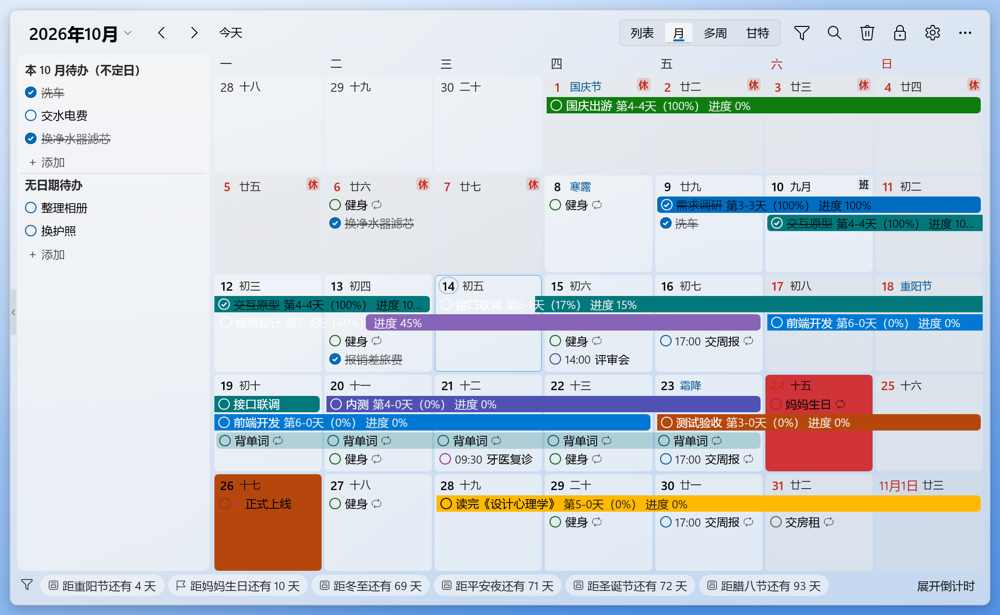
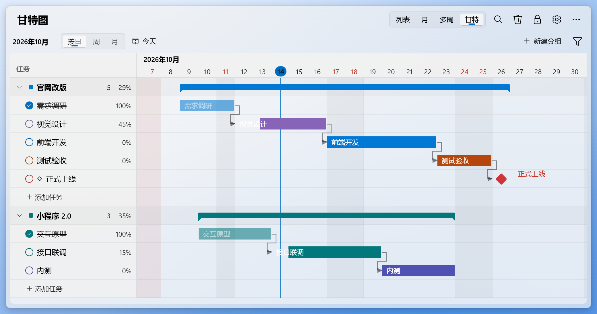
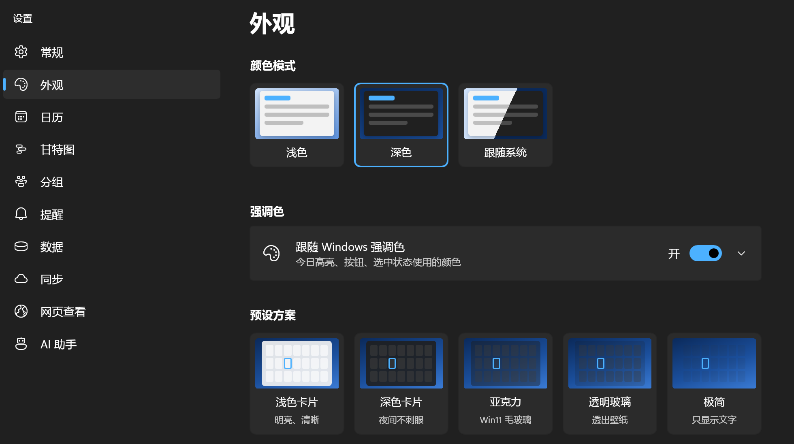
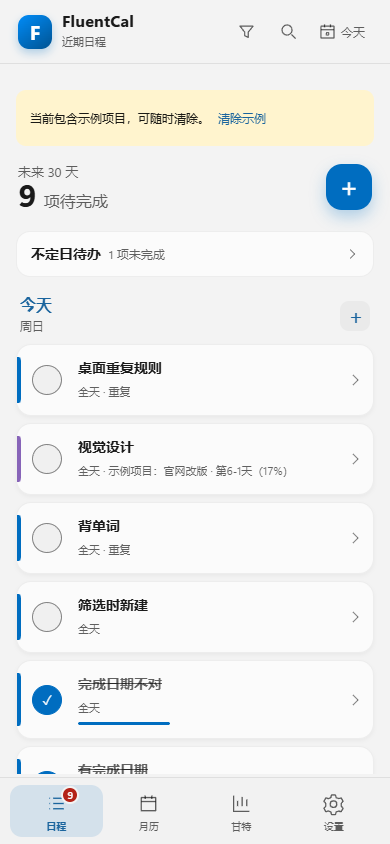

# FluentCal 桌面行事曆

[简体中文](README.md) · [繁體中文](README.zh-TW.md) · [English](README.en.md)

FluentCal 是原生 Windows 桌面行事曆與甘特圖。工作、日曆與專案計畫共用同一份資料；可離線使用，無需帳號，沒有廣告。

[Microsoft Store](https://apps.microsoft.com/store/detail/9NTT06453DG5?cid=DevShareMCLPCB) · [Windows 安裝程式](https://github.com/Lianzy-Baimiao/FluentCal/releases/latest) · [Android 用戶端](https://github.com/Lianzy-Baimiao/FluentCal/releases/tag/android-latest)

## 畫面

以下為簡體中文介面。

手機瀏覽器中的唯讀網頁檢視：

## 功能

- **行事曆與待辦**：月曆、多週與列表檢視；「所有」列表顯示不定日待辦及實際完成日期；農曆、節氣、節日與中國大陸法定假期。
- **甘特圖**：拖曳排程、追蹤進度、檢視分組與相依關係，並匯出 PNG/SVG。
- **搜尋與分組**：依分組篩選，可選擇在列表顯示分組標籤；最近變更可復原。
- **倒數計時**：新安裝預設顯示手動標記與一般節日。法定假期、節氣和任務分組可選；多日法定假期只從首日倒數。
- **外觀**：淺色、深色或跟隨系統；可分別自訂今日邊框、粗細與填充；調整背景、文字及任務顏色與透明度。
- **跨裝置**：可選 WebDAV、GitHub 或 Gitee 同步。網頁檢視為唯讀；Android 支援離線編輯、甘特圖和提醒。

雲端同步、網頁檢視與 AI 助手接入預設關閉，只有在設定中啟用後才會執行。

## 下載

從 [Microsoft Store](https://apps.microsoft.com/store/detail/9NTT06453DG5?cid=DevShareMCLPCB) 或 [GitHub Releases](https://github.com/Lianzy-Baimiao/FluentCal/releases/latest) 安裝 Windows 版。覆蓋升級會保留資料。需要 Windows 10 1809 或更新版本，x64。

從 [Android 發佈頁](https://github.com/Lianzy-Baimiao/FluentCal/releases/tag/android-latest)下載正式 APK，需要 Android 7.0+ 與 Android System WebView 120+。早期測試版遷移方式請見 [Android 使用說明](docs/ANDROID.md)。

## 常用操作

`Ctrl+Alt+D` 喚出或收起日曆 · `Ctrl+Alt+N` 新增工作 · `Ctrl+F` 搜尋 · `Ctrl+Z` / `Ctrl+Y` 復原 / 重做

在空白日期按兩下可新增工作；在工作上按右鍵可完成、改色、分組或刪除。請在 [GitHub Issues](https://github.com/Lianzy-Baimiao/FluentCal/issues) 回報問題或提出建議。
